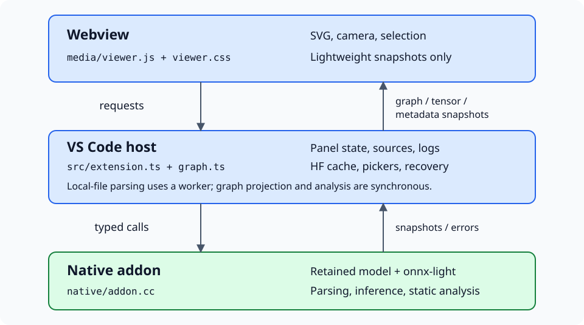
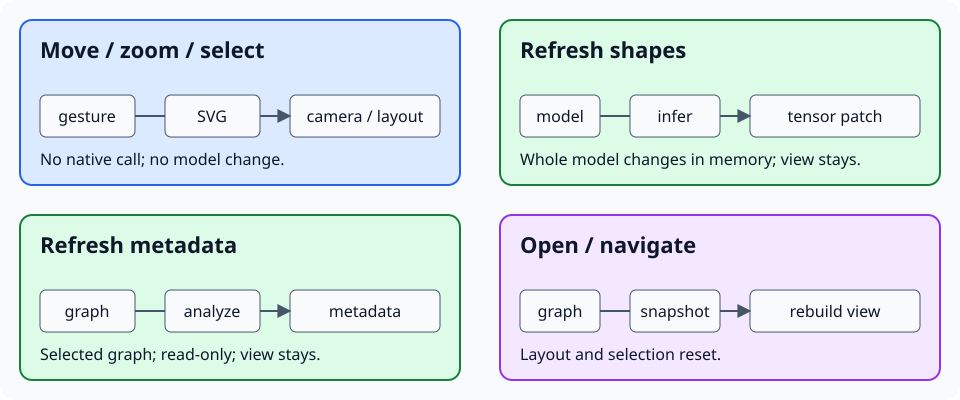
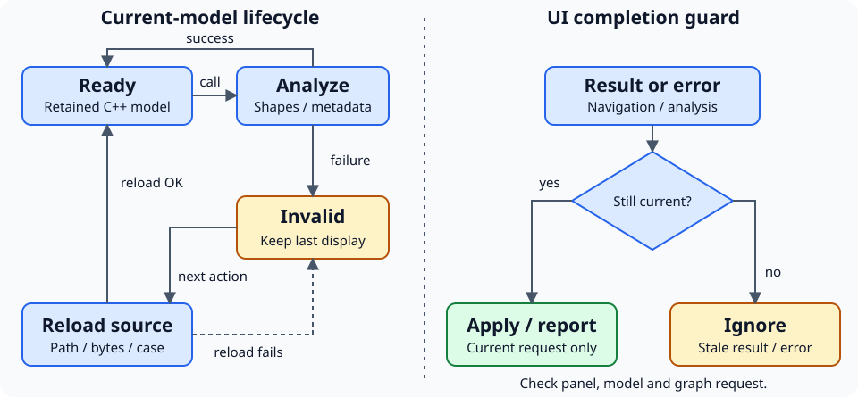
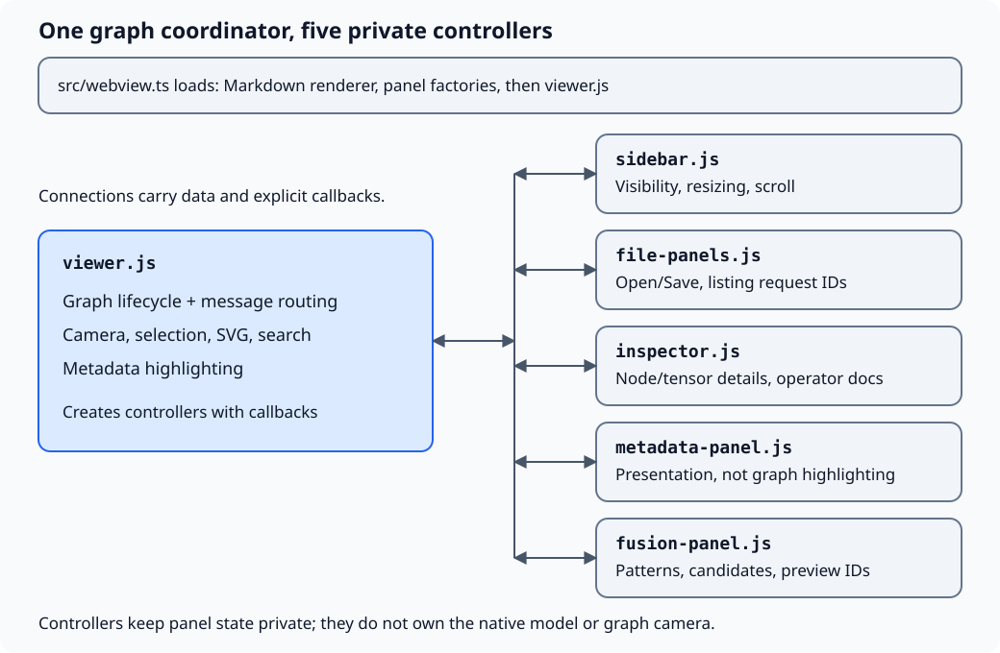
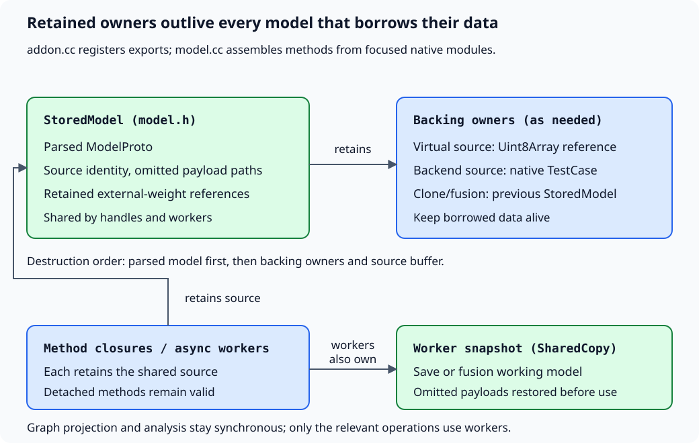

Application design
==================

Three layers: **VS Code manages sources and panel state**, **C++ retains and
analyzes the model**, and **the webview draws lightweight snapshots**.
There is no Python runtime or model-execution service on the default branch.
Saving explicitly writes a new model copy; it does not modify the source file.
See :doc:`features` for implemented/in-progress capabilities.

Who owns what?
--------------

         native addon and returns graph, tensor and metadata snapshots.
   :width: 100%

   Files and native handles stay outside the browser; the browser owns the view.

* Local files are streamed on a native worker, omitting large tensor payloads.
  Virtual sources retain their backing byte buffer; backend cases retain their
  native owner. Keep borrowed buffers unchanged while a handle is alive.
  Small available tensor values can be included in previews.
* Hugging Face downloads enter the persistent cache only after successful native
  loading and atomic publication. Recovery uses the final local cache path.
* Graph projection and analysis are synchronous. Only the selected graph is
  projected, not every descendant.
* Inline Open/Save submit masked password fields, cleared after submission or
  closing their panel. Direct editor opening uses a host password prompt.
  Decryption passwords remain in panel-local reload closures and are never logged.

What does an action change?
---------------------------

         the in-memory model and patches tensors; metadata is read-only.
         Opening or navigating replaces the graph view.
   :width: 100%

   Shape and metadata replies preserve the camera, positions and selection.
   A new graph snapshot rebuilds the view.

The protocol uses ``postMessage`` in both directions:

.. list-table::
   :header-rows: 1
   :widths: 32 36 32

   * - Request
     - Reply
     - Meaning
   * - ``open`` / ``navigate``
     - ``graph``
     - Replace the displayed graph.
   * - ``browse-files``
     - ``file-list`` or ``file-list-error``
     - List folders, model files or backend cases inside the sidebar.
   * - ``save``
     - ``save-info`` or ``save-error``
     - Write a plain or encrypted model copy, optionally with external weights.
   * - ``fusion-patterns`` / ``preview-fusion``
     - ``fusion-patterns`` / ``fusion-preview``
     - List native patterns and preview their candidates without editing.
   * - ``apply-fusion`` / ``cancel-fusion``
     - ``graph`` and ``fusion-info`` / no reply
     - Apply selected disjoint candidates or discard the preview.
   * - ``refresh-shapes``
     - ``shape-info``
     - Patch tensor descriptions.
   * - ``metadata``
     - ``metadata-info``
     - Update separate static analysis.
   * - ``ready``
     - Snapshots, history and status
     - Restore the webview without reloading the model.

Failures have dedicated error replies and action-log entries. Shape and metadata
analysis first run ``VerifyModel``; invalid connectivity can still be displayed
without running either analysis. Update counts compare successful snapshots,
not runtime measurements.

What happens after an error?
----------------------------

         display. The next native action reloads the source. A completion is
         applied only if its panel, model and graph request are still current.
   :width: 100%

   The addon stays loaded; only the model handle is replaced.

Concurrent actions can share one recovery promise. Handlers discard stale
results **and errors** after disposal, model replacement or superseding
navigation. A reload can lose prior in-memory inference; local sources must
remain available. Logs retain failures across model changes and webview
recreation. This recovers caught exceptions, not native process crashes.
After fusion, recovery clones the retained edited model instead of reloading
the original source, preserving applied rewrites.

How do the panel modules cooperate?
-----------------------------------

``src/webview.ts`` loads the local Markdown renderer, the five panel factories,
then ``media/viewer.js``, under the same CSP. The viewer creates the controllers
with explicit callbacks; no framework or bundler is needed for these modules.

         inspector, metadata panel and fusion panel. Data and explicit callbacks
         connect them; graph state remains in the viewer.
   :width: 100%

   Extracting a panel does not transfer ownership of the graph or camera.

The viewer routes file and fusion replies to their controllers, which reject
superseded request IDs. A replacement graph resets inspector/metadata displays,
clears operator documentation, and invalidates file listings and fusion previews.
Metadata presentation belongs to its panel; tensor highlighting and selection
remain in the viewer.
See :doc:`features/inspection` and :doc:`features/navigation` for the user-facing
behavior.

How does the native split preserve ownership?
---------------------------------------------

``native/addon.cc`` only registers exports. ``model.cc`` assembles the retained
handle from graph methods and the serialization/fusion method factories.
The focused translation units share narrow declarations, not global model state;
workers and implementation helpers remain private to their source file.

         StoredModel. It owns the parsed model and the relevant backing owners.
         Workers also own a working snapshot for serialization or fusion.
   :width: 100%

   Splitting source files does not shorten the lifetime of borrowed storage.

Each method closure captures the shared ``StoredModel``, so even a detached
method keeps its source alive. Clones and fusion results retain the previous
``StoredModel`` as backing; virtual-file models retain their byte array and
backend models retain their test case. Member declaration order ensures that
the parsed model is destroyed before these backing owners.

Save and fusion workers retain their source and operate on a ``SharedCopy``
snapshot, restoring omitted payloads before use. This is not a promise of
bounded-memory saving or fusion: those operations can materialize weights.
Graph projection and analysis remain synchronous; splitting translation units
does not move them onto workers. See :doc:`features/opening_models` and
:doc:`features/fusion_patterns` for the action semantics.

Contracts worth keeping
------------------------

* ``NativeModel.graph(inferShapes?, path?)`` projects one graph; requesting
  inference updates the enclosing model first. ``metadata(path?)`` returns a
  separate, read-only analysis snapshot. ``serialize`` and ``serializeFiles``
  save the retained model as a new plain, encrypted or external-weight copy.
* Fusion materializes weights in an independent native snapshot. Selected
  patterns apply together against original node indices; overlapping candidates
  are rejected. Graph replacement or cancellation invalidates previews.
  Replacement previews share one trial builder per pattern without rewriting
  the matched graph. External-weight reuse indexes candidates by name, element
  type and dimensions before comparing their payloads and checking backing files.
* ``GraphPath`` uses validated indices, not potentially duplicate names.
  Functions use their own imports and formal names, not the caller's weights;
  nested graph attributes can capture enclosing values.
* Tensor dimensions remain strings. ``[]`` means scalar, ``null`` means unknown
  rank; non-tensor types can omit the shape.
* Model text arrives through messages, not HTML interpolation. Operator docs
  use bundled Markdown rendering with raw HTML disabled, HTTP(S)-only links and
  no remote image fetching.
* Large graphs attach only visible SVG details. **Fit** uses batched paths;
  search indexes all nodes, including those without a current DOM element.
  Moving nodes updates only their groups and incident edges.

Where to change things
----------------------

.. list-table::
   :header-rows: 1
   :widths: 38 62

   * - Source
     - Responsibility
   * - :download:`src/extension.ts <../src/extension.ts>`
     - Commands, sources, panel state, routing and recovery.
   * - :download:`src/graph.ts <../src/graph.ts>`
     - Typed snapshots, native model API and addon loading.
   * - :download:`src/huggingface.ts <../src/huggingface.ts>`
     - URL normalization, downloads and persistent cache.
   * - :download:`src/log.ts <../src/log.ts>`
     - Correlated action history and status.
   * - :download:`native/addon.cc <../native/addon.cc>`
     - Node-API export registration.
   * - :download:`native/model.cc <../native/model.cc>` /
       :download:`model.h <../native/model.h>`
     - Retained handles and backing-buffer ownership.
   * - :download:`native/model_io.cc <../native/model_io.cc>`
     - Loading, bounded protobuf parsing, decryption and payload recovery.
   * - :download:`native/model_storage.cc <../native/model_storage.cc>`
     - Shared tensor traversal and external payload loading.
   * - :download:`native/model_serialization.cc <../native/model_serialization.cc>`
     - Save workers, external-weight reuse and serialization methods.
   * - :download:`native/fusion.cc <../native/fusion.cc>`
     - Pattern enumeration, preview and fusion workers.
   * - :download:`native/graph_analysis.cc <../native/graph_analysis.cc>`
     - Graph-path scopes, metadata analysis and shape inference.
   * - :download:`native/graph_snapshot.cc <../native/graph_snapshot.cc>`
     - Graph snapshots, initializer descriptions and operator schemas.
   * - :download:`native/tensor_preview.cc <../native/tensor_preview.cc>`
     - Bounded attribute previews and small inline tensor values.
   * - :download:`src/webview.ts <../src/webview.ts>`
     - HTML shell, local resources and content security policy.
   * - :download:`media/viewer.js <../media/viewer.js>` /
       :download:`viewer.css <../media/viewer.css>`
     - Graph snapshots, selection, camera, SVG layout, gestures and search.
   * - :download:`media/sidebar.js <../media/sidebar.js>`
     - Panel visibility, scrolling and resizing.
   * - :download:`media/file-panels.js <../media/file-panels.js>`
     - Open/Save forms, file browsing and stale listing guards.
   * - :download:`media/inspector.js <../media/inspector.js>`
     - Node/tensor details and safe operator documentation rendering.
   * - :download:`media/metadata-panel.js <../media/metadata-panel.js>`
     - Metadata presentation; graph highlighting stays in the viewer.
   * - :download:`media/fusion-panel.js <../media/fusion-panel.js>`
     - Pattern/candidate controls and stale preview guards.

``CMakeLists.txt`` pins and checksum-verifies the published onnx-light libraries;
only the addon is compiled locally. Its platform must match the extension host.
Tests mirror the boundaries: native graph tests, host routing tests and webview
DOM/SVG tests. Build commands and validation details are in :doc:`development`.
