Implemented features
====================

The viewer inspects ONNX graphs locally with onnx-light. Models are not uploaded.
Explicit Convert and Run actions execute installed tooling;
inspection does not save or modify the source file.

Available in the viewer
-----------------------

This overview describes the default branch, not every capability of the
underlying onnx-light libraries. Start with the worked example in
:doc:`getting_started`; the linked guides explain each control in detail.

Controls are grouped by theme: **Navigation** (including statistics),
**Convert**, **Optimization** and **Application** (logs, status, help and settings).
Model actions remain in the sidebar; application tabs are available without
loading a model. See :doc:`features/navigation`.

.. figure:: _static/feature-themes.png
   :alt: Viewer with Navigation and Application tab groups and Navigation, Convert and Optimization sidebar groups.
   :width: 100%

   Find related controls together without changing the model.

Opening models
^^^^^^^^^^^^^^

Open local ``.onnx`` and ``.pipe-onnx`` files, bundled demos or public Hugging Face
models with persistent caching. See :doc:`features/opening_models`.
No authentication or automatic external weight downloads.
Buttons below **Model path** offer the VS Code file picker and an in-app folder
dialog for paths outside the workspace.

.. figure:: _static/feature-opening.png
   :alt: Open panel with compact buttons below Model path for in-app browsing and the VS Code file picker.
   :width: 100%

   Choose how to fill Model path without loading a model.

**Recent paths** checks local files for generation assets without loading weights
or running inference. Mobius exports show whether a pipeline can be assembled,
or explain missing assets and unsupported input contracts. **Load as pipeline**
creates a native ``PipelineProto`` beside the export, reusing external weights
and leaving the original models unchanged, then opens **Run → Prompt**. Separate
embedding/decoder exports and declared past/present caches are connected in C++;
onnx-light owns generation and cache feedback. Existing pipelines can be opened
directly. Inspection does not reorder history; only a successful open does.
These checks do not certify runtime operator support.

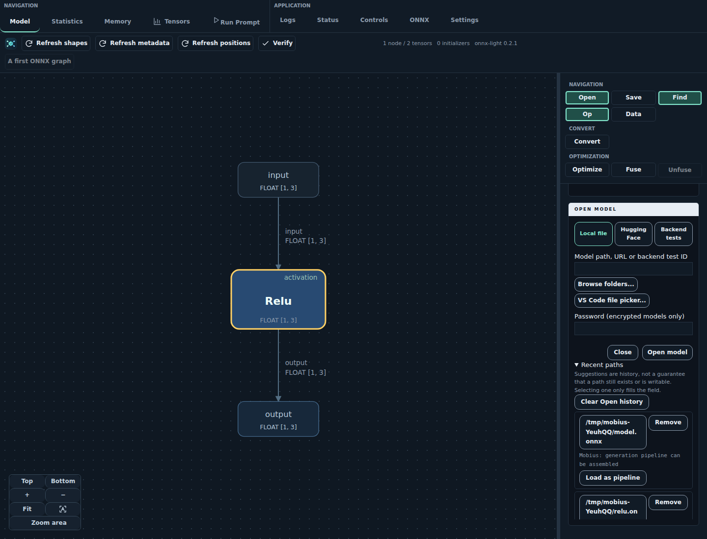

   Identify a usable export before loading it; this screenshot uses a tiny test model.

Backend catalog
^^^^^^^^^^^^^^^

Search bundled onnx-light cases and inspect their model graphs.
See :doc:`features/backend_tests`; this opens graphs, not a test runner.

.. figure:: _static/feature-backend.png
   :alt: Backend test catalog filtered to Attention cases.
   :width: 100%

   Find a bundled case by name.

Converting models
^^^^^^^^^^^^^^^^^

Run installed mbext, modelbuilder, Mobius or Olive exporters with visible commands,
live output, cancellation and a saved reproduction script; open their output.
See :doc:`features/exporting_models`. Requires Python and a trusted workspace;
exporter packages and checkpoints are not installed automatically.

.. figure:: _static/feature-conversion.png
   :alt: Convert panel with exporter, model source, output directory and precision controls.
   :width: 100%

   Configure an exporter before launching conversion.

Olive export, quantization and recipes
^^^^^^^^^^^^^^^^^^^^^^^^^^^^^^^^^^^^^^

Export a Hugging Face model ID or local checkpoint to ONNX with Olive, optimize
an ONNX model, or select a model-specific recipe. Configure precision, CPU/CUDA
target and advanced export parameters. Local-only ONNX quantization remains a
separate workflow.
The recipe catalogue is cached by Git commit, retains version-pinned entries and
shows their required Olive version. See :doc:`features/exporting_models`.

.. figure:: _static/feature-olive.png
   :alt: Olive checkpoint export with model ID, target, precision and advanced parameters.
   :width: 100%

   Export checkpoints without preparing an ONNX file first.

.. figure:: _static/feature-olive-recipes.png
   :alt: Olive recipe controls showing the pinned Git commit and Olive requirements.
   :width: 100%

   Model-specific recipes retain their own source and parameters.

Navigation
^^^^^^^^^^

Zoom, pan, area zoom, readable-size views, multi-selection, dragging and sidebar
node/operator search with live suggestions. See :doc:`features/navigation`.
Moving a node changes only its display position.

Connections attach left-to-right in each node's input and output order.
Repeated inputs have separate entry points; empty outputs keep their slot as
a short, unlabeled line below the rectangle.

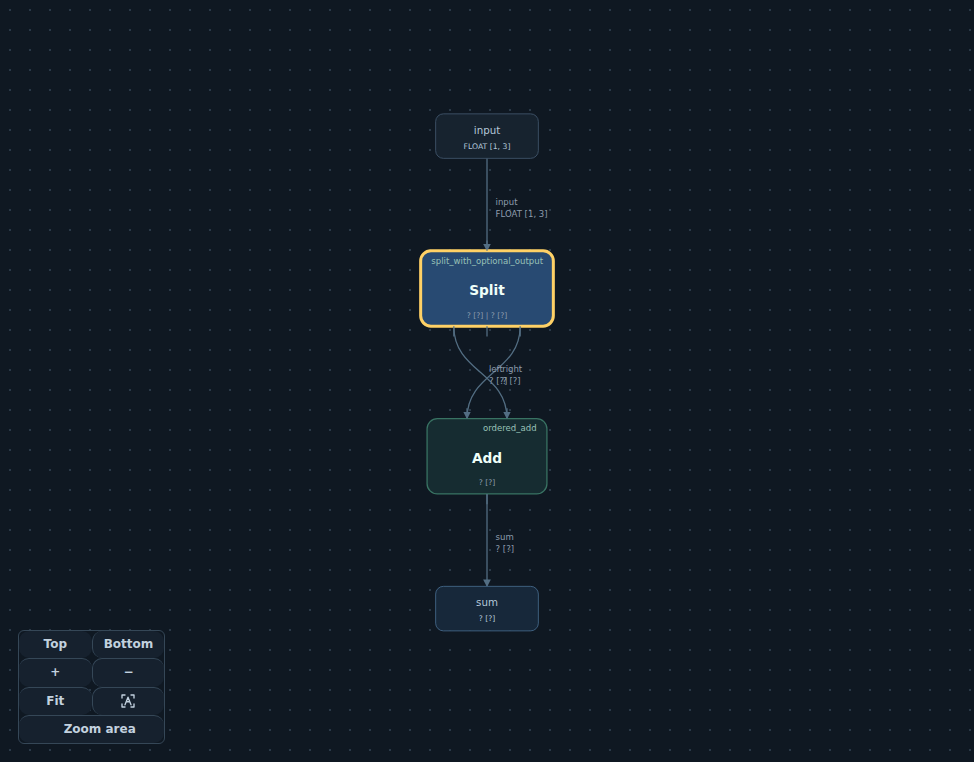

   Tensor slots determine connection points, even when connections cross.

Carried-result names are longer, with complete hover information. Nearby edge
labels stagger when space permits.

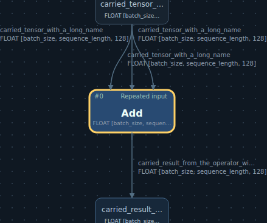

   Read edge labels without lining them all up on the same horizontal line.

.. figure:: _static/feature-navigation.png
   :alt: Selected Reshape node at readable zoom with graph navigation controls.
   :width: 100%

   Inspect a selected node at readable size.

Running a model
^^^^^^^^^^^^^^^

Open **Run** next to **Tensors**, then select its **Run** subtab for regular
CPU inference with **onnx-light** or **ONNX Runtime**. The **Prompt** subtab preserves language-model
generation. Regular execution uses the current model, including unsaved edits;
for a pipeline, choose a stage in **Model**.

Choose an **Engine** and its logging settings: onnx-light verbosity, or ONNX Runtime
severity and verbosity. Each engine retains its own values while switching.
ONNX Runtime requires ``onnx``, ``numpy`` and ``onnxruntime`` in the Python
environment selected in **Settings → App**; onnx-light uses the bundled native SDK.
**Settings** opens the selected engine's settings; **Back** returns to the Run subtab.
Check **Keep session loaded between runs** to reuse the actual model session
with either engine. Inputs are read or regenerated on each execution, including
changed dynamic dimensions. The status distinguishes a newly created session
from a reused one and says whether it is still loaded. **Unload session**, unchecking
the option, changing engine/logging/model/stage, cancellation or an error releases
the retained session. With the option off (the default), sessions are recreated
and released for every run. Initialization time is separate from execution time.

Every symbolic or unnamed dynamic dimension needs an explicit non-negative size.
Shared symbolic names use one field; unnamed dimensions are labeled ``input:axis``.
For each input, choose **Random** (SDK-generated normal samples), **TensorProto
file (.pb)** (inline binary protobuf, selected with **Browse…**) or **Tensor text**.
Random generation requires a tensor with known rank and an SDK-supported element
type; SDK errors are shown without a fallback. File tensors are bound to the
selected input name. For text, a three-element float input named ``X`` is
``float[3] X = {-1, 0, 2}``; its concrete shape must match the dimension fields.
Integer values are parsed natively without JavaScript rounding.
A trusted workspace is required.
**Load input (.pb)…** is always
visible next to each input source and automatically switches that input to file mode.
Use it to reload a saved input exactly, including integers beyond JavaScript's
exact-number range. Random inputs are otherwise regenerated on every run.
**Run model** displays execution time and actual input/output type, shape and values for
tensors up to 32 elements. Larger tensors show metadata only. Native errors
appear in the status; ONNX Runtime logs appear below it. Neither engine modifies
the graph. ONNX Runtime executes a temporary snapshot that is
removed after execution.

For each executed tensor, **Statistics** opens SDK summaries, quartiles,
histograms and a heatmap without running the model again. **Save statistics…**
exports the summary as JSON; **Save tensor…** exports the full inline TensorProto
(``.pb``), including values omitted from the preview. Saved tensors can be reused
as file inputs. Each save asks for a destination and can be cancelled. A new run
or model change invalidates the previous run's tensors. Non-tensor outputs have
no tensor inspection or save controls; unsupported statistics show the SDK error.

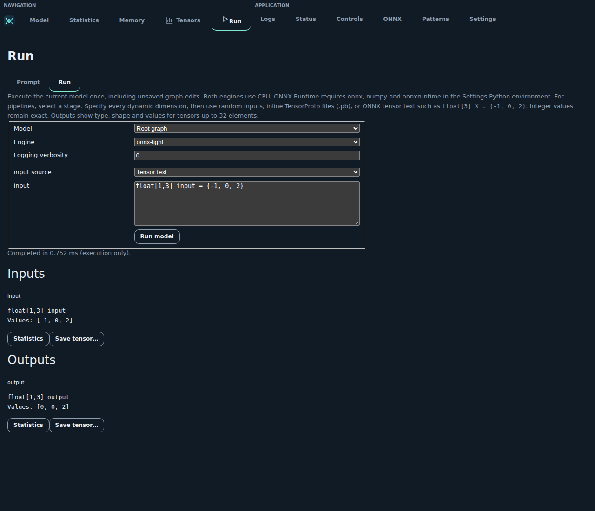

   Inspect or save each executed input and output.

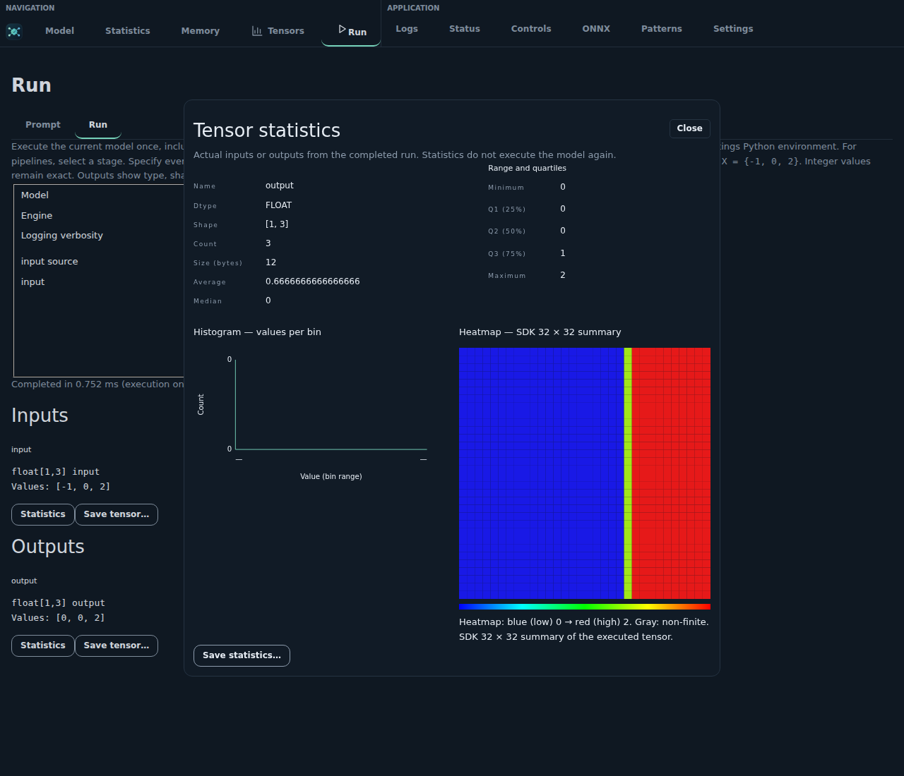

   Save the SDK statistics as JSON.

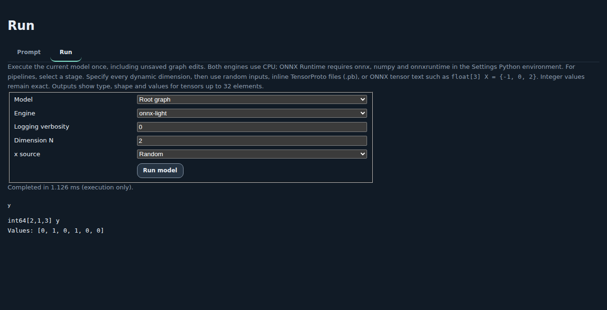

   Execute a regular model independently of language-model prompting.

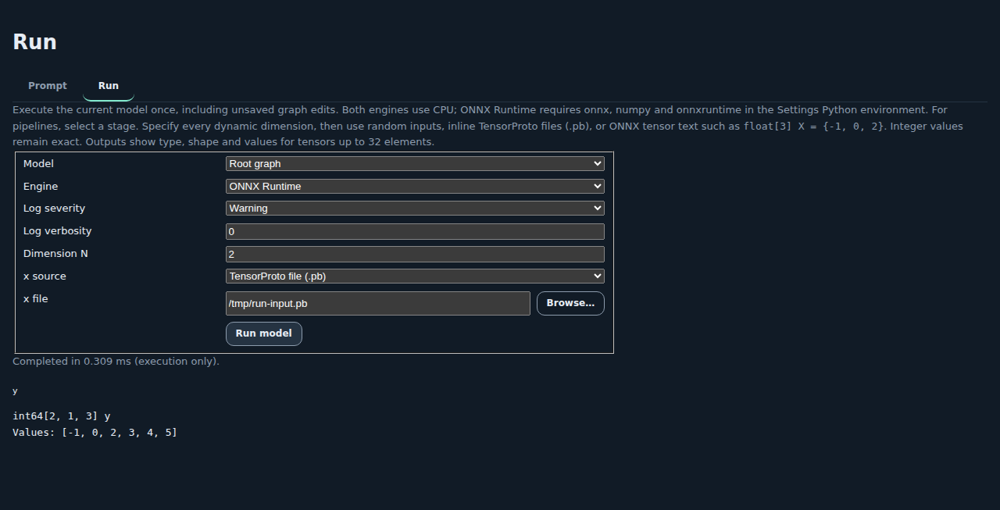

   Load saved inputs directly and save complete inputs and outputs.

Running language-model prompts
^^^^^^^^^^^^^^^^^^^^^^^^^^^^^^

After conversion, open **Run → Prompt** next to **Tensors**. Select **onnx-light**
or **onnxruntime-genai** (when a GenAI configuration is available), edit the
prompt and choose a maximum number of new tokens (default: 32). Requires a
trusted workspace and a causal language model. Both ONNX engines execute in
C++, in an isolated Node process so cancellation can stop native execution.
Execution uses the saved model, not unsaved graph edits.

The bundled onnx-light SDK supplies its CPU kernels. Native tokenization for both
engines uses the ONNX Runtime GenAI C API (0.17.0 or newer), not its Python module.
The tokenizer directory must contain ``genai_config.json`` and tokenizer assets
(``tokenizer.json`` or ``tokenizer_config.json`` with its referenced files).
For onnx-light, it must also contain a causal-model ``config.json``. Discovery
prefers a complete recorded source package, then the export directory; a bare
Hugging Face checkpoint without ``genai_config.json`` is not a native tokenizer
package. ONNX Runtime GenAI requires its package beside the exported model.
Install the matching C++ GenAI and ONNX Runtime libraries and set
``ONNX_LIGHT_VIEWER_GENAI_LIBRARY`` to the absolute GenAI shared-library path
before starting VS Code. Set ``ORT_LIB_PATH`` to the absolute ONNX Runtime
shared-library path when it is not already discoverable. Choose CPU/CUDA libraries
compatible with the exported configuration; the viewer installs neither.
Only Hugging Face validation needs ``torch``, ``transformers`` and the original
cached checkpoint in Settings' Python environment.

Conversion saves source information next to each exported model. **Validate
with Hugging Face** uses that source checkpoint and the same generated prefixes
to compare logits, rather than comparing unrelated divergent continuations.
Output text, token IDs, raw-logit scores and reference results share one column
per generated token. Each column includes maximum absolute and relative error,
L2 distance, and counts of vocabulary coefficients with absolute differences
below 0.01, 0.1 and 1. Runtime errors are shown without substituting another
engine; **Cancel** stops execution.

With either **onnx-light** or **onnxruntime-genai**, token columns appear as soon
as the C++ engine produces them. Each column includes its phase and latency in milliseconds.
The first token is **Prefill**; subsequent tokens are **Decode**. The summary
shows prefill time and the mean of decode tokens only; a one-token result has
no decode mean. Hugging Face validation also reports per-token timings, using
the prompt once and the exported token prefixes with its decode cache thereafter.
GenAI timings include inference and CPU logit transfer. onnx-light's SDK observer
measures per-iteration input preparation, embedding execution, inference and token
selection; it excludes per-call session construction, snapshot copying and callback
work. Neither engine includes loading, tokenization, detokenization, retained-logit
serialization or UI rendering in these token timings.

**Model loading** and **warmup** have separate timings. On each new native
session, warmup uses the first prompt token alone and generates one token;
the real run starts with a fresh generation/cache state. HF validation also
measures loading and a one-token warmup forward separately.
Native loading covers runtime, tokenizer and model/session initialization,
not viewer preflight discovery or prompt encoding.

**Keep the current model loaded** is optional and off by default to avoid
unnecessary memory use and swapping. A retained session reports its original
loading/warmup times as **initial** timings, not costs paid again. **Unload model
now**, cancellation, changing models/engines/settings and closing the panel
release it. One panel retains at most one native model; keeping it during HF
validation can hold two models in memory.

Select the engine on **Run → Prompt**, then open **Session settings** to jump to
its subtab in **Settings → Engine**. Controls preserve defaults unless changed and never edit the
exported configuration. GenAI's **-** uses the exported
configuration, or the engine default when the option is absent from that file.
onnx-light exposes allocation capacity, logging and native kernel profiles.
GenAI exposes graph optimization, memory options,
prepacking, graph execution mode, log ID/verbosity, custom operator libraries and ORT profiling. Unsupported
providers/options raise runtime errors, without switching engines.

**Settings → Engine → onnxruntime** lists each option, a compact value control
and its explanation in three columns. **Session configuration entries** already lists the keys: choose
a value or fill in its value field, without entering option names or JSON.
Blank values preserve ``genai_config.json`` and runtime defaults; clearing a
value removes its override. For example, select **0 - No** for
``session.intra_op.allow_spinning`` to reduce idle CPU use.
See the `ONNX Runtime configuration keys
<https://github.com/microsoft/onnxruntime/blob/main/include/onnxruntime/core/session/onnxruntime_session_options_config_keys.h>`_
for runtime-version requirements. Invalid values block generation; unsupported
runtime options are reported on Prompt. **Device** controls choose providers and
GPU settings; **Use providers from genai_config.json** preserves the exported
provider selection.

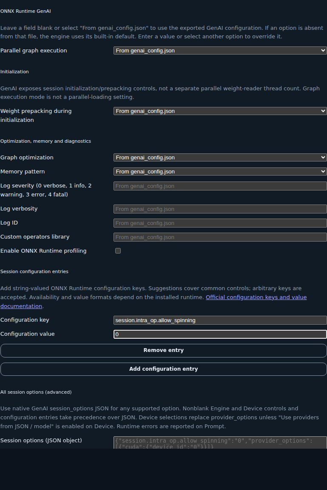

   Compact controls use - to preserve defaults; explanations appear on the right.

Open **Generation settings** from Prompt, or **Settings → Generation**, to set
**Temperature** (default **0**, greedy decoding) and **Maximum new tokens**
(default **32**, range **1–4096**, excluding input tokens). Positive temperatures
enable SDK sampling in either engine; EOS can stop generation before the limit.
These viewer-local values apply on the next run without changing exported files
or unloading a retained session. HF validation remains an argmax/logit comparison
at the generated prefixes, not a second sampled sequence.

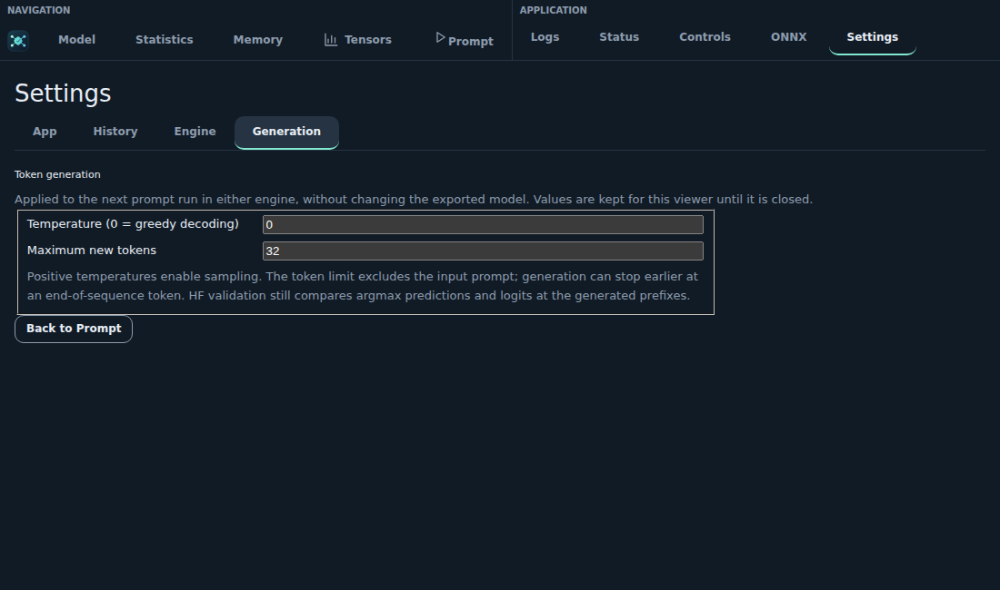

   Generation settings shared by the onnx-light and ONNX Runtime GenAI engines.

onnx-light loading, shape checking and intermediate release use their defaults;
these controls are not exposed in Settings.
GenAI exposes initialization/prepacking and session-thread controls, not a
separate parallel weight-reader thread count. Parallel graph execution is not
parallel loading. Profiles add overhead and are written under
``.prompt-profiles`` beside the model; unload GenAI to finalize its profile.

onnx-light 0.2.3 uses the SDK's synchronous ``GenerationOptions.on_step`` observer
for live tokens, genuine per-token timings and bounded raw last-position logits.
FLOAT, DOUBLE, FLOAT16 and BFLOAT16 outputs support raw scores and the same
token-aligned HF vocabulary comparisons as GenAI. If the capture budget is
exhausted, tokens and timings continue, while unavailable scores/comparisons are
identified explicitly. No timings are estimated by dividing the total runtime.
The onnx-light engine accepts ``eos_token_id`` as a non-negative integer or a list
of non-negative integers in ``generation_config.json`` or ``config.json``.
Generation stops on any listed EOS ID; an empty list disables EOS stopping.
Native pipeline generation uses the SDK's ``PipelineProto`` overload; unsupported
stages or inputs fail explicitly, without a viewer-side generation loop.
With the owning loader, the SDK's ``LoadedRuntimePipeline`` overload uses explicit
generation options: the viewer's token limit and temperature replace stored
sampling settings, while pipeline interface names and EOS defaults are preserved.

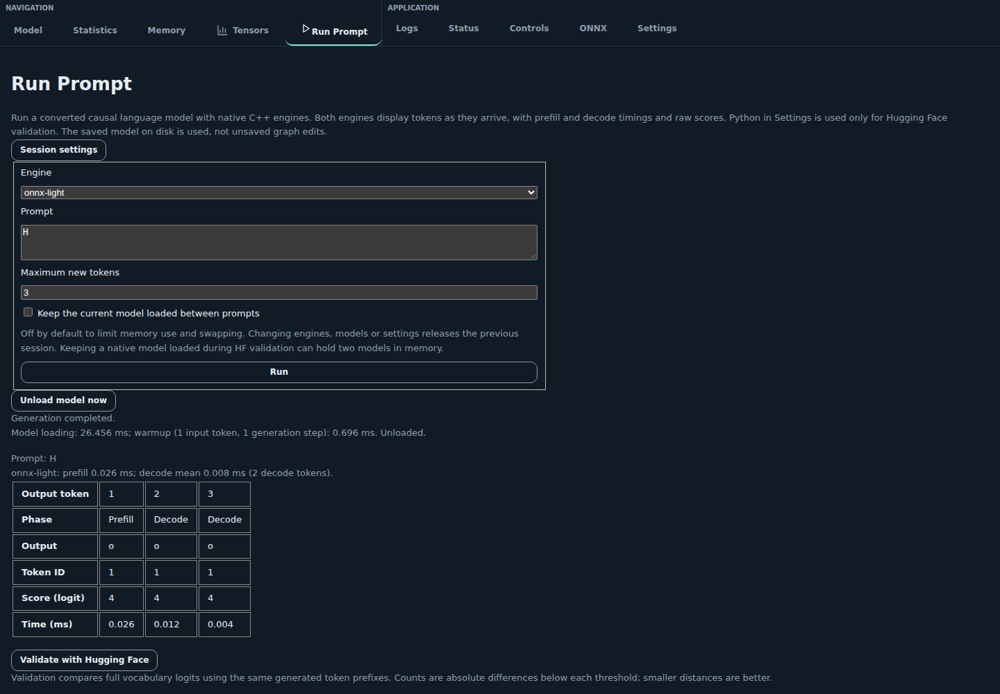

   Live SDK observations on a tiny deterministic test model, not an LLM benchmark.

.. figure:: _static/feature-run-prompt.png
   :alt: Run Prompt with native GenAI output columns, prefill and decode phases, individual token times and the decode mean.
   :width: 100%

   Real native GenAI timings on a tiny deterministic test model, not an LLM benchmark.

.. figure:: _static/feature-prompt-settings-light.png
   :alt: onnx-light session settings page with allocation capacity, logging and native profiling controls.
   :width: 100%

   Focused onnx-light session controls, backed by supported SDK APIs.

.. figure:: _static/feature-prompt-settings-genai.png
   :alt: GenAI session settings page with initialization, graph optimization, memory and profiling controls.
   :width: 100%

   GenAI session options are overlaid in memory; the exported configuration is unchanged.

Inspection
^^^^^^^^^^

Inspect types, symbolic shapes, attributes/schema defaults, dense/sparse/encoded
initializer metadata, opaque/structured types, bounded previews and Markdown
operator documentation. See :doc:`features/inspection`. External or omitted
payloads are not read for previews; this is not a full tensor-data browser.

.. figure:: _static/feature-inspection.png
   :alt: Reshape inspector showing input and output tensors, attributes and initializer details.
   :width: 100%

   Operator details accompany the selected graph node.

Tensor statistics
^^^^^^^^^^^^^^^^^

Open the statistics icon on a node, beside an inspector tensor, or in **Tensors**.
Use **Previous tensor** / **Next tensor** without closing the dialog.
From **Tensors**, navigation follows the filtered list across pages; from the
inspector, it follows the current scope's stored tensors.
Browse mean, median, extrema, quartiles, shape/dtype, a histogram and a square
color map. Low-bit numeric tensors and SDK-supported encoded quantized weights
are supported. See :doc:`features/inspection`.

.. figure:: _static/feature-tensor-statistics.png
   :alt: Tensor statistics dialog showing quantized weight statistics, histogram and square color map.
   :width: 100%

   Statistics describe stored values, without executing the graph.

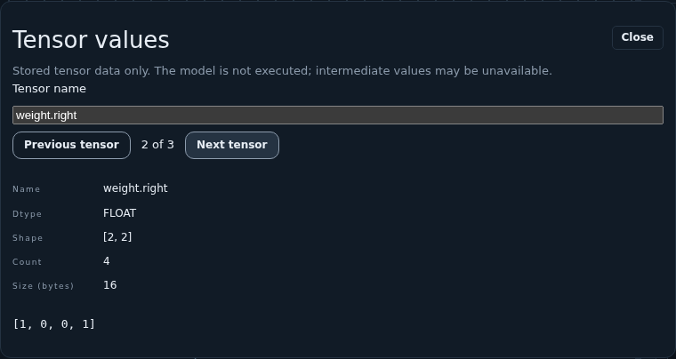

   Browse neighboring initializers without closing the dialog.

Stored tensor distributions
^^^^^^^^^^^^^^^^^^^^^^^^^^^

The **Tensors** tab groups stored weights and constants by type and shape,
showing tensor counts, elements and theoretical logical bytes. Dense, sparse
and encoded values stay separate; unknown sizes remain explicit.
No payload reads, decoding or execution are needed for these totals.
See :doc:`features/inspection`.

.. figure:: _static/feature-tensor-distributions.png
   :alt: Stored tensor distributions grouped by type and shape in the Tensors tab.
   :width: 100%

   Compare logical sizes independently of tensor-list filters.

Subgraphs and functions
^^^^^^^^^^^^^^^^^^^^^^^

Browse graph/list attributes, captured inputs, model-local function definitions
and nested graphs with breadcrumbs. See :doc:`features/subgraphs`.
Function bodies are definitions, not specialized executions of the selected call.

.. figure:: _static/feature-functions.png
   :alt: Local Transform function body with breadcrumbs back to the containing model.
   :width: 100%

   Navigate into a model-local function definition.

PipelineProto
^^^^^^^^^^^^^

Navigate stages and generation-settings previews, run per-stage inference and
fusion, and save whole containers with embedded or external weights.
See :doc:`features/opening_models`. No pipeline execution or encryption.

.. figure:: _static/feature-pipeline.png
   :alt: Pipeline overview showing embedding, prefill and decode model stages.
   :width: 100%

   Inspect the models contained in a pipeline.

Shape/type inference
^^^^^^^^^^^^^^^^^^^^

Open **Symbolic** and choose **Refresh shapes** for visible update counts and refreshed labels without
resetting the camera or selection. See :doc:`features/inspection`.
In-memory only; unsupported operators may fail.

.. figure:: _static/feature-inference.png
   :alt: Graph after Refresh shapes with inferred tensor labels and a visible update count.
   :width: 100%

   Refresh inferred shapes without modifying the source file.

Symbolic dimension names
^^^^^^^^^^^^^^^^^^^^^^^^

In **Symbolic**, choose **Shorten dimension names** to remove a common namespace
prefix, such as ``component.model.``. This edits the model; **Save** keeps the
renamed dimensions. No weight payloads are read during renaming.
See :doc:`features/inspection`.

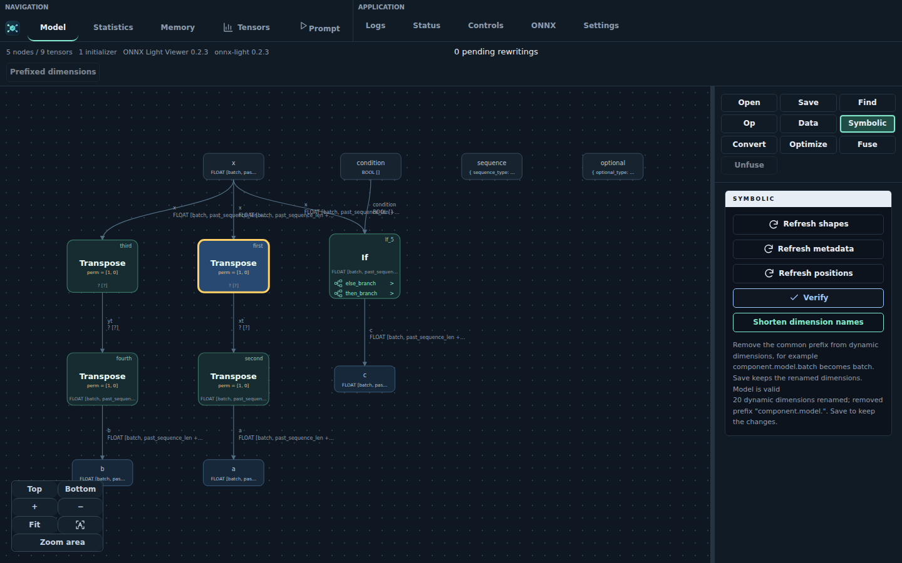

   Refresh, verify and simplify dimension names from one panel.

Static metadata
^^^^^^^^^^^^^^^

Inspect constants, tags, lifetimes, last reads, releasable/unused outputs and
stored model/graph/node/tensor metadata. See :doc:`features/metadata`.
This is static analysis, not measured runtime memory usage.

.. figure:: _static/feature-metadata.png
   :alt: Data panel displaying native tensor tags and lifetime information for a selected node.
   :width: 100%

   Inspect native metadata alongside operator details.

Statistics
^^^^^^^^^^

Open **Statistics** to refresh complete-model counts, operator/type distributions
and referenced file sizes, independently of nested navigation.

.. figure:: _static/feature-statistics.png
   :alt: Statistics tab with model counts, file size and operator distribution.
   :width: 100%

   Review the complete model rather than just the displayed subgraph.

Memory profiling
^^^^^^^^^^^^^^^^

Set dynamic dimensions and view the estimated CPU memory curve with paginated
per-node allocation/scratch events. Zoom for more operator labels and hover for
numerical and symbolic allocation details. See :doc:`features/memory_profiling`.
Native estimation, not model execution or measured RAM/GPU usage.
The matching Model graph shows reported in-place reuse as background port links.

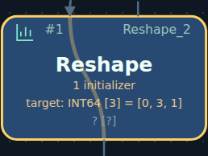

   Trace in-place reuse inside an operator after estimating memory.

.. figure:: _static/feature-memory.png
   :alt: Memory tab with zoom controls, CPU peak curve, and numerical and symbolic tensor allocation inspection.
   :width: 100%

   Estimate memory for concrete input dimensions without executing the model.

Optimizer backends
^^^^^^^^^^^^^^^^^^

In **Optimize**, choose **onnx-light** for native pattern selection or
**onnxscript** for Python optimization and fusion. ONNX Script requires a
trusted workspace and ``onnx`` and ``onnxscript`` in the configured Python
environment. Both operate on the current in-memory model, not the source file.
ONNX Script output appears below **Run global optimization** after completion,
including node and ``Identity`` counts before and after each stage.
Changed Python results cannot be unfused and clear earlier native undo history.
See :doc:`features/fusion_patterns`.

.. figure:: _static/feature-optimizer-backends.png
   :alt: Optimize panel with Python output reporting three nodes and two Identity nodes below Run, and Unfuse disabled.
   :width: 100%

   Read Python output without leaving Optimize.

With **onnx-light**, inspect **Matched patterns**, undo the last operation or
choose **Back to original model** without leaving Optimize.

Pattern groups
^^^^^^^^^^^^^^

Combine **Default**, ``L1``, ``L2``, ``Layer``, ``onnx-light-cpu`` or **All** in **Fuse**
or **Optimize**, even when their members overlap, then refine individual patterns.
Fuse selects only graph-applicable members; Optimize starts with **Default**
and leaves the opt-in ``RepeatedLayer`` unchecked. **All** includes it.
See :doc:`features/fusion_patterns`.
Choosing groups alone does not transform or save the model.

.. figure:: _static/feature-pattern-groups.png
   :alt: Optimize group tiles combining Default, Layer and onnx-light-cpu patterns.
   :width: 100%

   Named pattern sets are separate from optimization priorities.

Native fusion matching
^^^^^^^^^^^^^^^^^^^^^^

In **Fuse**, select patterns and click **Run Matching**. Inspect the **Before**
and **After** candidates, check compatible matches, then click **Fuse selected**.
Previewing does not modify the graph. See :doc:`features/fusion_patterns`.

.. figure:: _static/feature-fusion-patterns.png
   :alt: Fuse panel with two selected TransposeTranspose candidates, before and after operators, and Fuse selected.
   :width: 100%

   Inspect and select native matches before applying them.

Patterns from node selections
^^^^^^^^^^^^^^^^^^^^^^^^^^^^^

Select connected operators, right-click the selection and choose
**Create / edit FunctionPattern...** to create a ``FunctionPattern`` in a popup.
Inspect and copy its function text. Match and fuse occurrences across the model, undo with
**Unfuse**, or opt into the new **Selection patterns** optimization bucket.
Edit the match and replacement functions in SDK textparser syntax, then
**Apply edits**. The **Patterns** page lists created templates across models:
edit them there, **Save patterns...** to a portable library file, and
**Restore patterns...** in another viewer session. Restoration merges definitions
and asks before replacing existing ones; invalid files leave the library unchanged.
The popup also lists existing ONNX functions under **Patterns / model functions**:
edit **Function body**, then **Apply edits** to update every call and **Save**
to persist the change. See :doc:`features/fusion_patterns`.

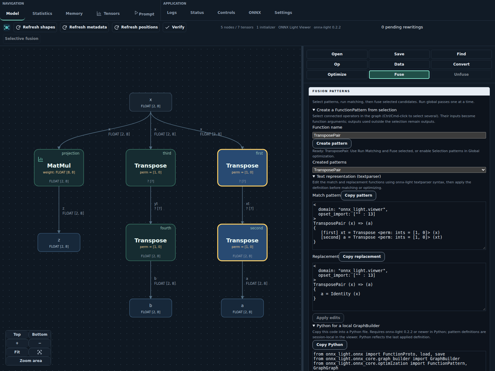

   Turn selected operators into a reusable local-function fusion.

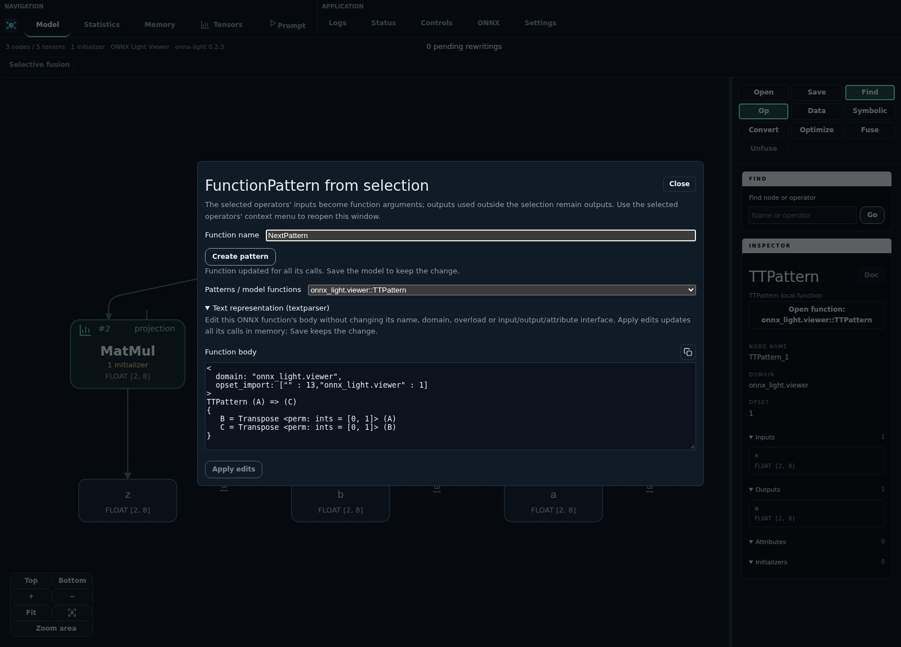

   Edit a function already present in a saved ONNX model.

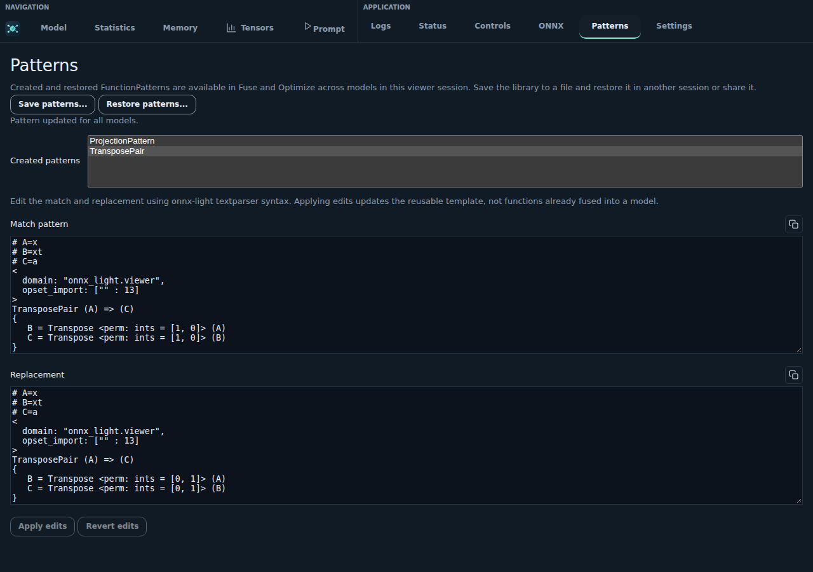

   Edit reusable templates and save or restore a shared pattern library.

Unfuse (undo native edits)
^^^^^^^^^^^^^^^^^^^^^^^^^^^^

Open **Unfuse**, beside **Fuse** in the **Optimization** sidebar group, to undo
native edits without changing the source file. **Unfuse last** reverses one
complete operation: a batch of selected matches, a global optimization, a
global pass or an applied rewriting-scenario step/batch. Repeat to go back
further, or choose **Unfuse all** to undo all available operations, including
those on other pipeline stages.
The history lists operations newest first; click a match to highlight its
surviving result nodes. These controls are disabled when no undo history remains.
See :ref:`unfuse` for history and saved rewriting-plan details.

The native **Optimize** panel also offers **Unfuse last** and
**Back to original model** (undo all). Changed ONNX Script results cannot be
undone and clear earlier native history; later native edits undo back to that
Python result. Saving does not persist the session's undo stack.

.. figure:: _static/feature-optimizer-history.png
   :alt: Native Optimize panel with matched patterns, highlighted result nodes, Unfuse last and Back to original model.
   :width: 100%

   Undo one native operation or all available native edits from Optimize.

Settings by category
^^^^^^^^^^^^^^^^^^^^

Open **Settings → App** to configure download and Python paths, sidebar width
and visible viewer panels, or reset viewer preferences.
Open **Settings → History** to inspect cache locations and remove or clear Open,
Save and conversion suggestions. Clearing history never deletes files.
Open **Settings → Device** to select devices independently; CPU and GPU selections
can coexist. Supported devices are selected by default after capability detection.
CPU fallback is always enabled; GPU selections use CUDA then DirectML priority.
CPU thread counts, the CPU memory arena and GPU limits are separate from engine
options. Detection requires workspace trust and the configured Python runtime;
it does not overwrite manual selections. onnx-light and Hugging Face validation
remain CPU-only.
Open **Settings → Engine** for **onnxruntime** and **onnx-light**
subtabs. ONNX Runtime GenAI and onnx-light share the session controls used by
Prompt; changes apply to the next run and remain in this viewer panel, without
changing the selected execution engine. Reference selection and validation remain
on Prompt.
Open **Settings → Generation** for temperature and maximum new tokens, shared
by both prompt engines.
Use Left/Right arrows, Home or End to switch categories or engine subtabs from
their tab buttons.

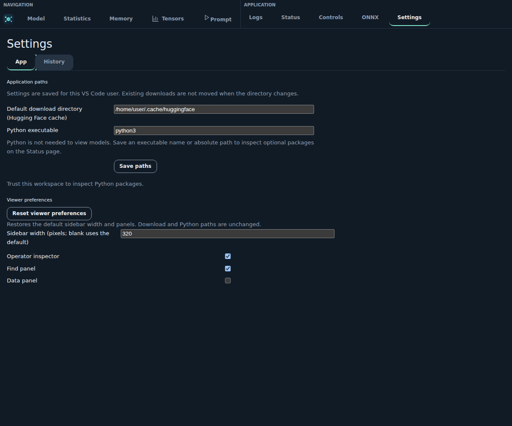

   Configure application paths and viewer preferences in App.

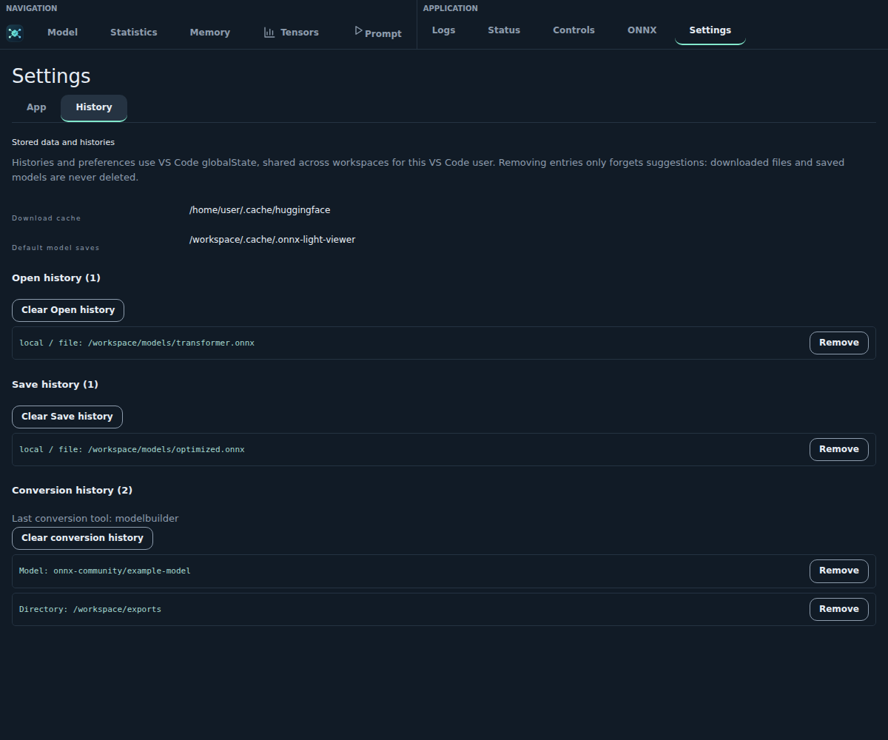

   Manage remembered suggestions separately in History.

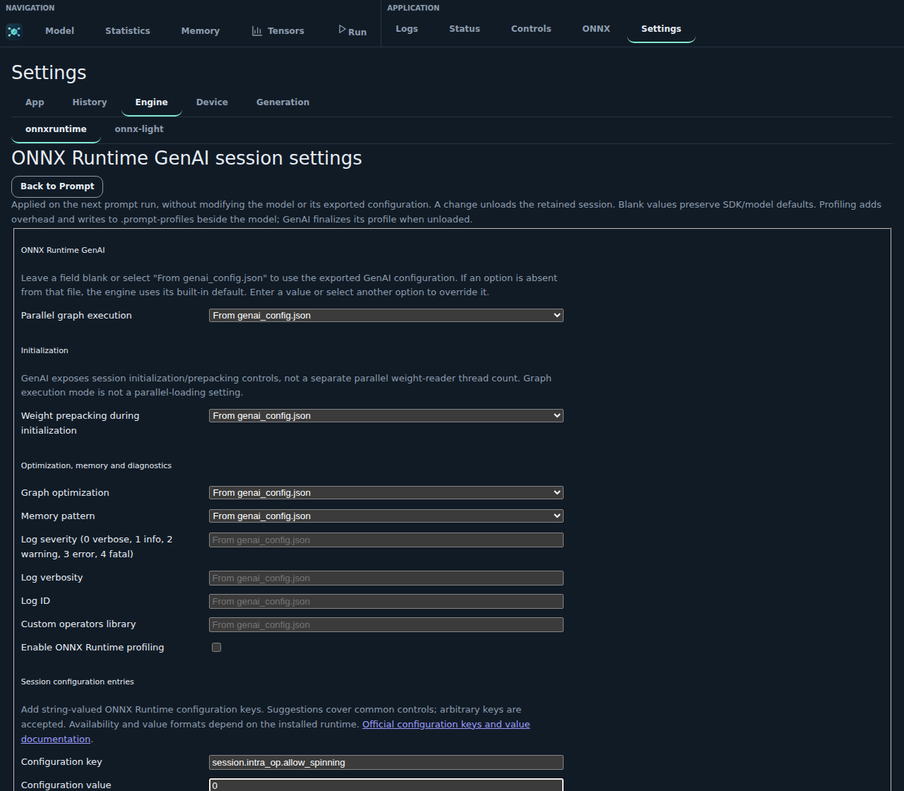

   Browse engine options independently of the engine selected for Prompt.

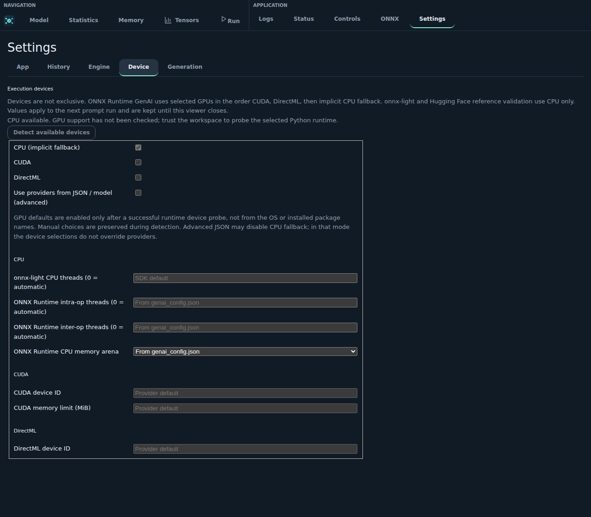

   Select devices separately from engine session options.

Diagnostics and help
^^^^^^^^^^^^^^^^^^^^

View action history, progress/errors, native-library status, recovery after caught
exceptions, keyboard/mouse controls and ONNX repository links.
See :doc:`features/action_logs`, :doc:`features/navigation` and :doc:`links`.

.. figure:: _static/feature-help.png
   :alt: Controls tab listing the viewer's mouse gestures and keyboard shortcuts.
   :width: 100%

   Find the navigation and selection controls.

Not yet available
-----------------

The following are not implemented features of the default branch. A capability
in onnx-light, onnx-light-cpu or ONNX Runtime does not imply a corresponding
viewer control.

.. list-table::
   :header-rows: 1
   :widths: 35 65

   * - Capability
     - Status
   * - Model saving and encrypted ModelProto I/O
     - In progress in `PR #115
       <https://github.com/xadupre/onnx-light-viewer/pull/115>`_, including embedded
       and plain external-weight export. Not available on ``main`` yet.
   * - Other graph transformations
     - Planned: weight quantization and rewriting
       scenarios/pipelines.
   * - Full tensor analytics
     - Planned: statistics, histograms, color maps and decoded payload browsing.
       Opaque/structured type and encoded layout previews are already available.
   * - Execution and benchmarking
     - Planned: whole-model/subgraph execution, CPU/CUDA engine comparison and
       input/output export with reproducible execution scripts.

Detailed guides
---------------

.. toctree::
   :maxdepth: 1

   features/opening_models
   features/exporting_models
   features/navigation
   features/inspection
   features/subgraphs
   features/metadata
   features/memory_profiling
   features/fusion_patterns
   features/backend_tests
   features/action_logs
