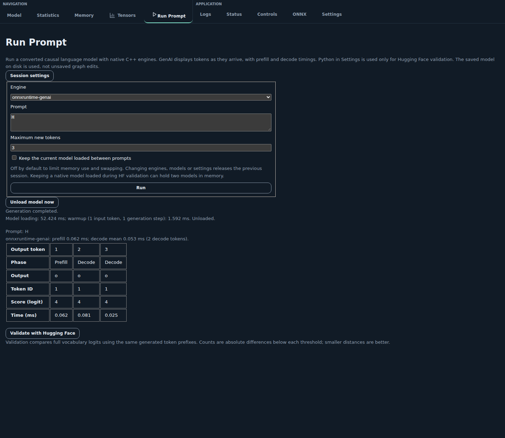
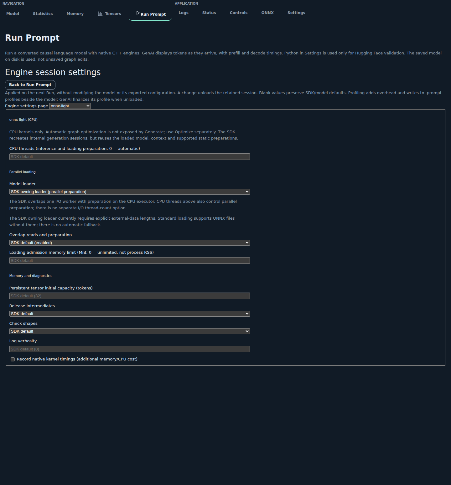
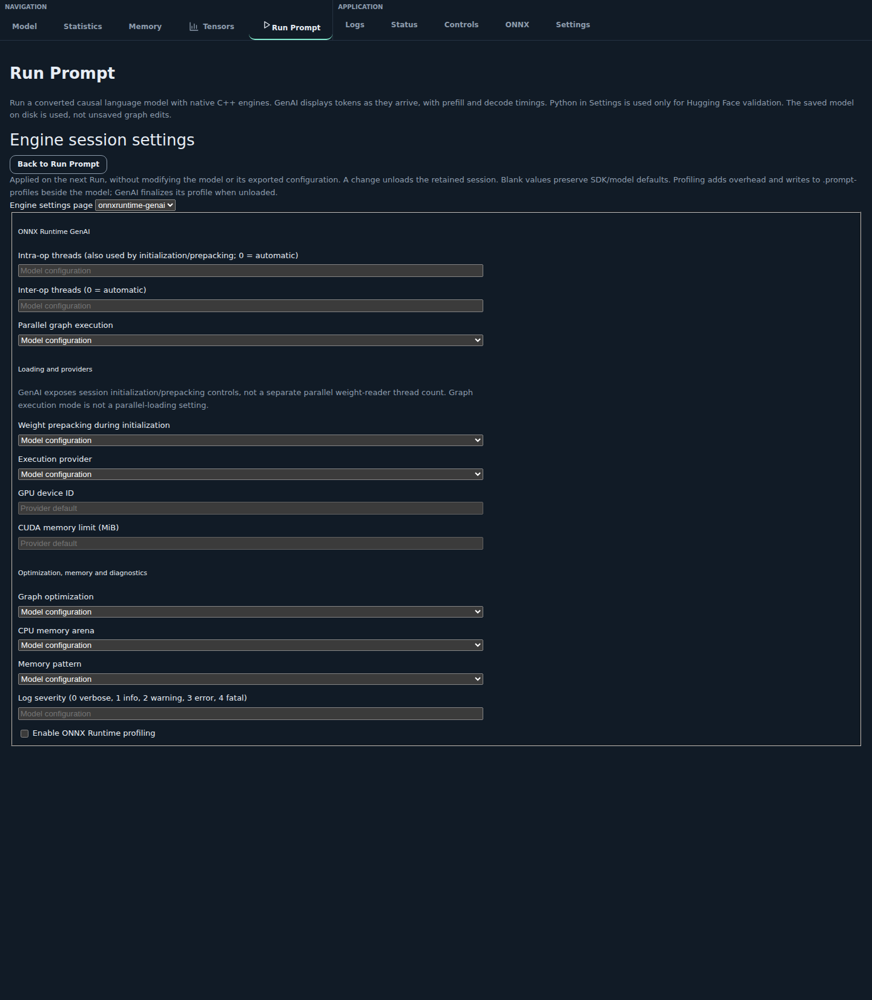

Implemented features
====================

The viewer inspects ONNX graphs locally with onnx-light. Models are not uploaded.
Explicit Convert and Run Prompt actions execute installed tooling;
inspection does not save or modify the source file.

Available in the viewer
-----------------------

This overview describes the default branch, not every capability of the
underlying onnx-light libraries. Start with the worked example in
:doc:`getting_started`; the linked guides explain each control in detail.

Controls are grouped by theme: **Navigation** (including statistics),
**Convert**, **Optimization** and **Application** (logs, status, help and settings).
Model actions remain in the sidebar; application tabs are available without
loading a model. See :doc:`features/navigation`.

.. figure:: _static/feature-themes.png
   :alt: Viewer with Navigation and Application tab groups and Navigation, Convert and Optimization sidebar groups.
   :width: 100%

   Find related controls together without changing the model.

Opening models
^^^^^^^^^^^^^^

Open local ``.onnx`` and ``.pipe-onnx`` files, bundled demos or public Hugging Face
models with persistent caching. See :doc:`features/opening_models`.
No authentication or automatic external weight downloads.
Buttons below **Model path** offer the VS Code file picker and an in-app folder
dialog for paths outside the workspace.

.. figure:: _static/feature-opening.png
   :alt: Open panel with compact buttons below Model path for in-app browsing and the VS Code file picker.
   :width: 100%

   Choose how to fill Model path without loading a model.

Backend catalog
^^^^^^^^^^^^^^^

Search bundled onnx-light cases and inspect their model graphs.
See :doc:`features/backend_tests`; this opens graphs, not a test runner.

.. figure:: _static/feature-backend.png
   :alt: Backend test catalog filtered to Attention cases.
   :width: 100%

   Find a bundled case by name.

Converting models
^^^^^^^^^^^^^^^^^

Run installed mbext, modelbuilder, Mobius or Olive exporters with visible commands,
live output, cancellation and a saved reproduction script; open their output.
See :doc:`features/exporting_models`. Requires Python and a trusted workspace;
exporter packages and checkpoints are not installed automatically.

.. figure:: _static/feature-conversion.png
   :alt: Convert panel with exporter, model source, output directory and precision controls.
   :width: 100%

   Configure an exporter before launching conversion.

Olive export, quantization and recipes
^^^^^^^^^^^^^^^^^^^^^^^^^^^^^^^^^^^^^^

Export a Hugging Face model ID or local checkpoint to ONNX with Olive, optimize
an ONNX model, or select a model-specific recipe. Configure precision, CPU/CUDA
target and advanced export parameters. Local-only ONNX quantization remains a
separate workflow.
The recipe catalogue is cached by Git commit, retains version-pinned entries and
shows their required Olive version. See :doc:`features/exporting_models`.

.. figure:: _static/feature-olive.png
   :alt: Olive checkpoint export with model ID, target, precision and advanced parameters.
   :width: 100%

   Export checkpoints without preparing an ONNX file first.

.. figure:: _static/feature-olive-recipes.png
   :alt: Olive recipe controls showing the pinned Git commit and Olive requirements.
   :width: 100%

   Model-specific recipes retain their own source and parameters.

Navigation
^^^^^^^^^^

Zoom, pan, area zoom, readable-size views, multi-selection, dragging and sidebar
node/operator search with live suggestions. See :doc:`features/navigation`.
Moving a node changes only its display position.

.. figure:: _static/feature-navigation.png
   :alt: Selected Reshape node at readable zoom with graph navigation controls.
   :width: 100%

   Inspect a selected node at readable size.

Running language-model prompts
^^^^^^^^^^^^^^^^^^^^^^^^^^^^^^

After conversion, open **Run Prompt** next to **Tensors**. Select **onnx-light**
or **onnxruntime-genai** (when a GenAI configuration is available), edit the
prompt and choose a maximum number of new tokens (default: 32). Requires a
trusted workspace and a causal language model. Both ONNX engines execute in
C++, in an isolated Node process so cancellation can stop native execution.
Execution uses the saved model, not unsaved graph edits.

The bundled onnx-light SDK supplies its CPU kernels. Native tokenization for both
engines uses the ONNX Runtime GenAI C API (0.17.0 or newer), not its Python module.
Install the matching C++ GenAI and ONNX Runtime libraries and set
``ONNX_LIGHT_VIEWER_GENAI_LIBRARY`` to the absolute GenAI shared-library path
before starting VS Code. Set ``ORT_LIB_PATH`` to the absolute ONNX Runtime
shared-library path when it is not already discoverable. Choose CPU/CUDA libraries
compatible with the exported configuration; the viewer installs neither.
Only Hugging Face validation needs ``torch``, ``transformers`` and the original
cached checkpoint in Settings' Python environment.

Conversion saves source information next to each exported model. **Validate
with Hugging Face** uses that source checkpoint and the same generated prefixes
to compare logits, rather than comparing unrelated divergent continuations.
Output text, token IDs, raw-logit scores and reference results share one column
per generated token. Each column includes maximum absolute and relative error,
L2 distance, and counts of vocabulary coefficients with absolute differences
below 0.01, 0.1 and 1. Runtime errors are shown without substituting another
engine; **Cancel** stops execution.

With **onnxruntime-genai**, token columns appear as soon as the C++ engine
produces them. Each column includes its phase and latency in milliseconds.
The first token is **Prefill**; subsequent tokens are **Decode**. The summary
shows prefill time and the mean of decode tokens only; a one-token result has
no decode mean. Hugging Face validation also reports per-token timings, using
the prompt once and the exported token prefixes with its decode cache thereafter.
Timings include inference and CPU logit transfer, but exclude loading,
tokenization, detokenization, retained-logit serialization and UI rendering.

**Model loading** and **warmup** have separate timings. On each new native
session, warmup uses the first prompt token alone and generates one token;
the real run starts with a fresh generation/cache state. HF validation also
measures loading and a one-token warmup forward separately.
Native loading covers runtime, tokenizer and model/session initialization,
not viewer preflight discovery or prompt encoding.

**Keep the current model loaded** is optional and off by default to avoid
unnecessary memory use and swapping. A retained session reports its original
loading/warmup times as **initial** timings, not costs paid again. **Unload model
now**, cancellation, changing models/engines/settings and closing the panel
release it. One panel retains at most one native model; keeping it during HF
validation can hold two models in memory.

Open **Session settings** for a separate page per engine. Controls preserve
SDK/model defaults unless changed and never edit the exported configuration.
onnx-light exposes CPU threads, shape checks, allocation capacity, intermediate
release, logging and native kernel profiles. GenAI exposes CPU threads,
CPU/CUDA/DirectML providers and GPU limits, graph optimization, memory options,
prepacking, graph execution mode, logging and ORT profiling. Unsupported
providers/options raise runtime errors, without switching engines.

For **parallel loading**, select onnx-light's **SDK owning loader**, then
configure read/preparation overlap and its admission memory limit. One SDK I/O
worker overlaps preparation on the CPU executor; CPU threads also apply to
preparation. Standard ONNX loading remains the default. The owning loader
currently requires explicit external-data lengths
(`xadupre/onnx-light#5697 <https://github.com/xadupre/onnx-light/issues/5697>`_)
and does not accept pipelines
(`xadupre/onnx-light#5698 <https://github.com/xadupre/onnx-light/issues/5698>`_).
GenAI exposes initialization/prepacking and session-thread controls, not a
separate parallel weight-reader thread count. Parallel graph execution is not
parallel loading. Profiles add overhead and are written under
``.prompt-profiles`` beside the model; unload GenAI to finalize its profile.

The onnx-light C++ ``Generate`` API currently returns completed token IDs only.
Streaming, individual token timings, scores and discrepancy metrics are explicitly
unavailable, not estimated by dividing the total runtime. These capabilities are
tracked in `xadupre/onnx-light#5692
<https://github.com/xadupre/onnx-light/issues/5692>`_.
Native pipeline generation uses the SDK's ``PipelineProto`` overload; unsupported
stages or inputs fail explicitly, without a viewer-side generation loop.

   Real native GenAI timings on a tiny deterministic test model, not an LLM benchmark.

   onnx-light session and parallel-loading controls, backed by supported SDK APIs.

   GenAI session options are overlaid in memory; the exported configuration is unchanged.

Inspection
^^^^^^^^^^

Inspect types, symbolic shapes, attributes/schema defaults, dense/sparse/encoded
initializer metadata, opaque/structured types, bounded previews and Markdown
operator documentation. See :doc:`features/inspection`. External or omitted
payloads are not read for previews; this is not a full tensor-data browser.

.. figure:: _static/feature-inspection.png
   :alt: Reshape inspector showing input and output tensors, attributes and initializer details.
   :width: 100%

   Operator details accompany the selected graph node.

Tensor statistics
^^^^^^^^^^^^^^^^^

Open **Tensor statistics** for selected nodes or a connection, **All tensors**
for the current scope, or **Tensor statistics** beside an inspector tensor.
Browse mean, median, extrema, quartiles, shape/dtype, a histogram and a square
color map. Low-bit numeric tensors and SDK-supported encoded quantized weights
are supported. See :doc:`features/inspection`.

.. figure:: _static/feature-tensor-statistics.png
   :alt: Tensor statistics dialog showing quantized weight statistics, histogram and square color map.
   :width: 100%

   Statistics describe stored values, without executing the graph.

Stored tensor distributions
^^^^^^^^^^^^^^^^^^^^^^^^^^^

The **Tensors** tab groups stored weights and constants by type and shape,
showing tensor counts, elements and theoretical logical bytes. Dense, sparse
and encoded values stay separate; unknown sizes remain explicit.
No payload reads, decoding or execution are needed for these totals.
See :doc:`features/inspection`.

.. figure:: _static/feature-tensor-distributions.png
   :alt: Stored tensor distributions grouped by type and shape in the Tensors tab.
   :width: 100%

   Compare logical sizes independently of tensor-list filters.

Subgraphs and functions
^^^^^^^^^^^^^^^^^^^^^^^

Browse graph/list attributes, captured inputs, model-local function definitions
and nested graphs with breadcrumbs. See :doc:`features/subgraphs`.
Function bodies are definitions, not specialized executions of the selected call.

.. figure:: _static/feature-functions.png
   :alt: Local Transform function body with breadcrumbs back to the containing model.
   :width: 100%

   Navigate into a model-local function definition.

PipelineProto
^^^^^^^^^^^^^

Navigate stages and generation-settings previews, run per-stage inference and
fusion, and save whole containers with embedded or external weights.
See :doc:`features/opening_models`. No pipeline execution or encryption.

.. figure:: _static/feature-pipeline.png
   :alt: Pipeline overview showing embedding, prefill and decode model stages.
   :width: 100%

   Inspect the models contained in a pipeline.

Shape/type inference
^^^^^^^^^^^^^^^^^^^^

Choose **Refresh shapes** for visible update counts and refreshed labels without
resetting the camera or selection. See :doc:`features/inspection`.
In-memory only; unsupported operators may fail.

.. figure:: _static/feature-inference.png
   :alt: Graph after Refresh shapes with inferred tensor labels and a visible update count.
   :width: 100%

   Refresh inferred shapes without modifying the source file.

Static metadata
^^^^^^^^^^^^^^^

Inspect constants, tags, lifetimes, last reads, releasable/unused outputs and
stored model/graph/node/tensor metadata. See :doc:`features/metadata`.
This is static analysis, not measured runtime memory usage.

.. figure:: _static/feature-metadata.png
   :alt: Data panel displaying native tensor tags and lifetime information for a selected node.
   :width: 100%

   Inspect native metadata alongside operator details.

Statistics
^^^^^^^^^^

Open **Statistics** to refresh complete-model counts, operator/type distributions
and referenced file sizes, independently of nested navigation.

.. figure:: _static/feature-statistics.png
   :alt: Statistics tab with model counts, file size and operator distribution.
   :width: 100%

   Review the complete model rather than just the displayed subgraph.

Memory profiling
^^^^^^^^^^^^^^^^

Set dynamic dimensions and view the estimated CPU memory curve with paginated
per-node allocation/scratch events. See :doc:`features/memory_profiling`.
Native estimation, not model execution or measured RAM/GPU usage.

.. figure:: _static/feature-memory.png
   :alt: Memory tab with a dynamic dimension set to two, CPU peak estimate, curve and node events.
   :width: 100%

   Estimate memory for concrete input dimensions without executing the model.

Optimizer backends
^^^^^^^^^^^^^^^^^^

In **Optimize**, choose **onnx-light** for native pattern selection or
**onnxscript** for Python optimization and fusion. ONNX Script requires a
trusted workspace and ``onnx`` and ``onnxscript`` in the configured Python
environment. Both operate on the current in-memory model, not the source file.
ONNX Script output appears below **Run global optimization** after completion,
including node and ``Identity`` counts before and after each stage.
Changed Python results cannot be unfused and clear earlier native undo history.
See :doc:`features/fusion_patterns`.

.. figure:: _static/feature-optimizer-backends.png
   :alt: Optimize panel with Python output reporting three nodes and two Identity nodes below Run, and Unfuse disabled.
   :width: 100%

   Read Python output without leaving Optimize.

With **onnx-light**, inspect **Matched patterns**, undo the last operation or
choose **Back to original model** without leaving Optimize.

Pattern groups
^^^^^^^^^^^^^^

Combine **Default**, ``L1``, ``L2``, ``Layer``, ``onnx-light-cpu`` or **All** in **Fuse**
or **Optimize**, even when their members overlap, then refine individual patterns.
Fuse selects only graph-applicable members; Optimize starts with **Default**
and leaves the opt-in ``RepeatedLayer`` unchecked. **All** includes it.
See :doc:`features/fusion_patterns`.
Choosing groups alone does not transform or save the model.

.. figure:: _static/feature-pattern-groups.png
   :alt: Optimize group tiles combining Default, Layer and onnx-light-cpu patterns.
   :width: 100%

   Named pattern sets are separate from optimization priorities.

Native fusion matching
^^^^^^^^^^^^^^^^^^^^^^

In **Fuse**, select patterns and click **Run Matching**. Inspect the **Before**
and **After** candidates, check compatible matches, then click **Fuse selected**.
Previewing does not modify the graph. See :doc:`features/fusion_patterns`.

.. figure:: _static/feature-fusion-patterns.png
   :alt: Fuse panel with two selected TransposeTranspose candidates, before and after operators, and Fuse selected.
   :width: 100%

   Inspect and select native matches before applying them.

Unfuse (undo native edits)
^^^^^^^^^^^^^^^^^^^^^^^^^^^^

Open **Unfuse**, beside **Fuse** in the **Optimization** sidebar group, to undo
native edits without changing the source file. **Unfuse last** reverses one
complete operation: a batch of selected matches, a global optimization, a
global pass or an applied rewriting-scenario step/batch. Repeat to go back
further, or choose **Unfuse all** to undo all available operations, including
those on other pipeline stages.
The history lists operations newest first; click a match to highlight its
surviving result nodes. These controls are disabled when no undo history remains.
See :ref:`unfuse` for history and saved rewriting-plan details.

The native **Optimize** panel also offers **Unfuse last** and
**Back to original model** (undo all). Changed ONNX Script results cannot be
undone and clear earlier native history; later native edits undo back to that
Python result. Saving does not persist the session's undo stack.

.. figure:: _static/feature-optimizer-history.png
   :alt: Native Optimize panel with matched patterns, highlighted result nodes, Unfuse last and Back to original model.
   :width: 100%

   Undo one native operation or all available native edits from Optimize.

Diagnostics and help
^^^^^^^^^^^^^^^^^^^^

View action history, progress/errors, native-library status, recovery after caught
exceptions, keyboard/mouse controls and ONNX repository links.
See :doc:`features/action_logs`, :doc:`features/navigation` and :doc:`links`.

.. figure:: _static/feature-help.png
   :alt: Controls tab listing the viewer's mouse gestures and keyboard shortcuts.
   :width: 100%

   Find the navigation and selection controls.

Not yet available
-----------------

The following are not implemented features of the default branch. A capability
in onnx-light, onnx-light-cpu or ONNX Runtime does not imply a corresponding
viewer control.

.. list-table::
   :header-rows: 1
   :widths: 35 65

   * - Capability
     - Status
   * - Model saving and encrypted ModelProto I/O
     - In progress in `PR #115
       <https://github.com/xadupre/onnx-light-viewer/pull/115>`_, including embedded
       and plain external-weight export. Not available on ``main`` yet.
   * - Other graph transformations
     - Planned: weight quantization and rewriting
       scenarios/pipelines.
   * - Full tensor analytics
     - Planned: statistics, histograms, color maps and decoded payload browsing.
       Opaque/structured type and encoded layout previews are already available.
   * - Execution and benchmarking
     - Planned: whole-model/subgraph execution, CPU/CUDA engine comparison and
       input/output export with reproducible execution scripts.

Detailed guides
---------------

.. toctree::
   :maxdepth: 1

   features/opening_models
   features/exporting_models
   features/navigation
   features/inspection
   features/subgraphs
   features/metadata
   features/memory_profiling
   features/fusion_patterns
   features/backend_tests
   features/action_logs
