Implemented features
====================

The viewer inspects ONNX graphs locally with onnx-light. Models are not uploaded
or executed, and viewer actions do not save or modify the source file.

Available in the viewer
-----------------------

This overview describes the default branch, not every capability of the
underlying onnx-light libraries. Start with the worked example in
:doc:`getting_started`; the linked guides explain each control in detail.

Controls are grouped by theme: **Navigation** (including statistics),
**Convert**, **Optimization** and **Application** (logs, status, help and settings).
Model actions remain in the sidebar; application tabs are available without
loading a model. See :doc:`features/navigation`.

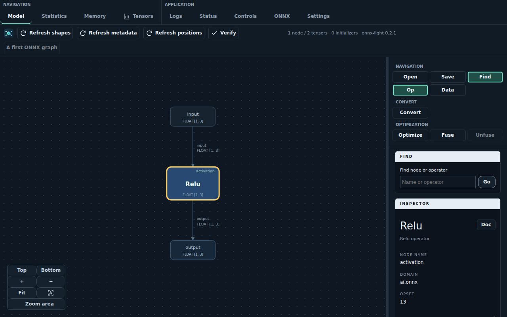

   Find related controls together without changing the model.

Opening models
^^^^^^^^^^^^^^

Open local ``.onnx`` and ``.pipe-onnx`` files, bundled demos or public Hugging Face
models with persistent caching. See :doc:`features/opening_models`.
No authentication or automatic external weight downloads.
Buttons below **Model path** offer the VS Code file picker and an in-app folder
dialog for paths outside the workspace.

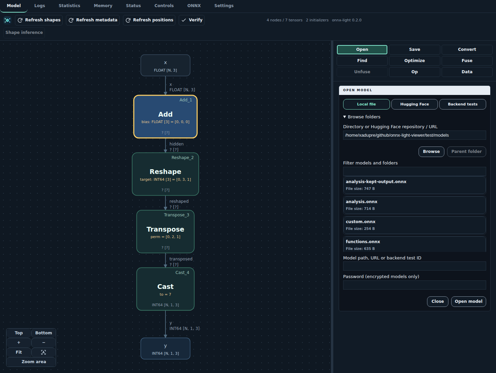

   Choose how to fill Model path without loading a model.

Backend catalog
^^^^^^^^^^^^^^^

Search bundled onnx-light cases and inspect their model graphs.
See :doc:`features/backend_tests`; this opens graphs, not a test runner.

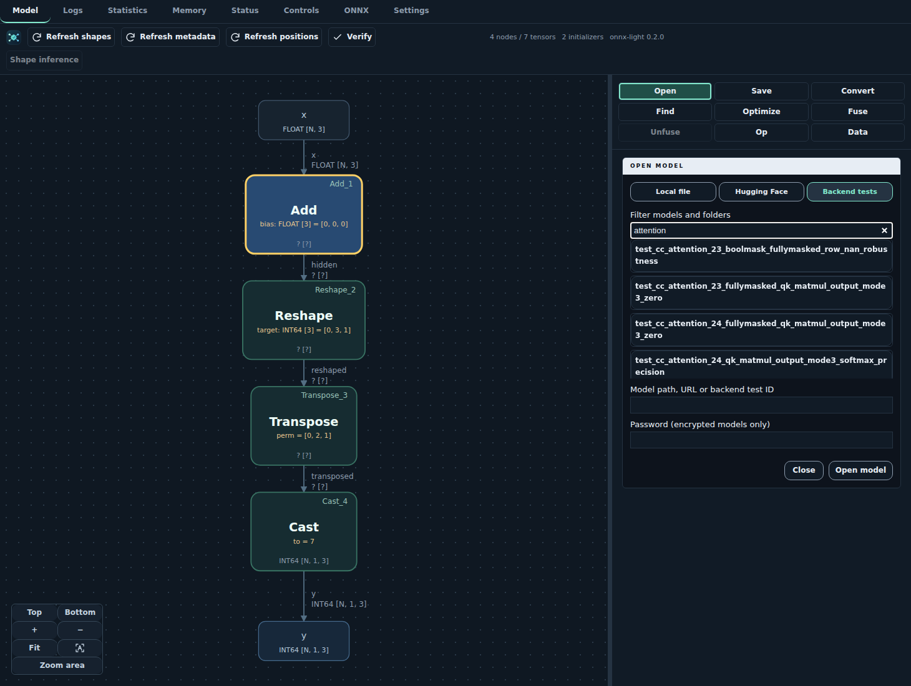

   Find a bundled case by name.

Converting models
^^^^^^^^^^^^^^^^^

Run installed mbext, modelbuilder, Mobius or Olive exporters with visible commands,
live output, cancellation and a saved reproduction script; open their output.
See :doc:`features/exporting_models`. Requires Python and a trusted workspace;
exporter packages and checkpoints are not installed automatically.

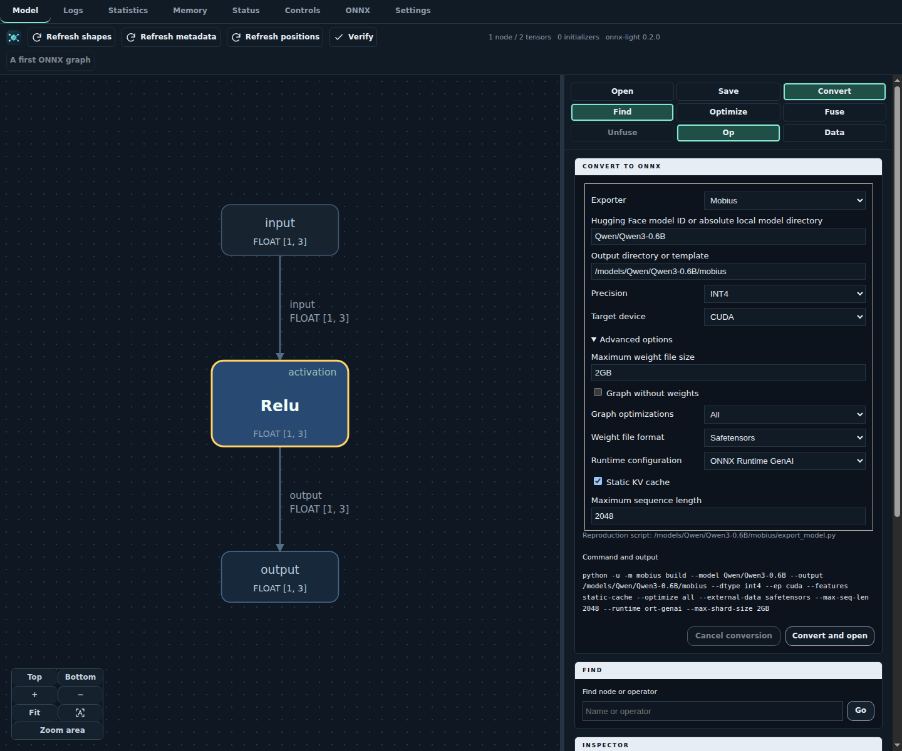

   Configure an exporter before launching conversion.

Olive export, quantization and recipes
^^^^^^^^^^^^^^^^^^^^^^^^^^^^^^^^^^^^^^

Export a Hugging Face model ID or local checkpoint to ONNX with Olive, optimize
an ONNX model, or select a model-specific recipe. Configure precision, CPU/CUDA
target and advanced export parameters. Local-only ONNX quantization remains a
separate workflow.
The recipe catalogue is cached by Git commit, retains version-pinned entries and
shows their required Olive version. See :doc:`features/exporting_models`.

.. figure:: _static/feature-olive.png
   :alt: Olive checkpoint export with model ID, target, precision and advanced parameters.
   :width: 100%

   Export checkpoints without preparing an ONNX file first.

.. figure:: _static/feature-olive-recipes.png
   :alt: Olive recipe controls showing the pinned Git commit and Olive requirements.
   :width: 100%

   Model-specific recipes retain their own source and parameters.

Navigation
^^^^^^^^^^

Zoom, pan, area zoom, readable-size views, multi-selection, dragging and sidebar
node/operator search with live suggestions. See :doc:`features/navigation`.
Moving a node changes only its display position.

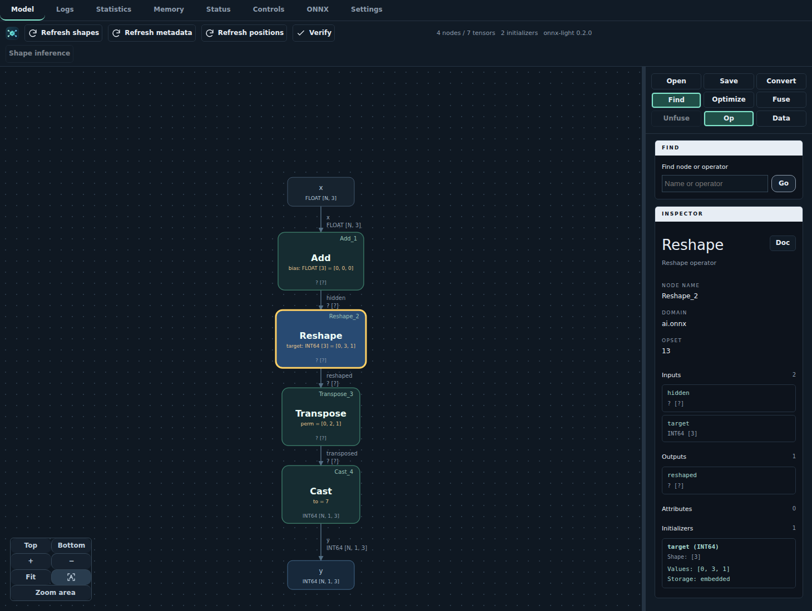

   Inspect a selected node at readable size.

Inspection
^^^^^^^^^^

Inspect types, symbolic shapes, attributes/schema defaults, dense/sparse/encoded
initializer metadata, opaque/structured types, bounded previews and Markdown
operator documentation. See :doc:`features/inspection`. External or omitted
payloads are not read for previews; this is not a full tensor-data browser.

   Operator details accompany the selected graph node.

Tensor statistics
^^^^^^^^^^^^^^^^^

Open **Tensor statistics** for selected nodes or a connection, **All tensors**
for the current scope, or **Tensor statistics** beside an inspector tensor.
Browse mean, median, extrema, quartiles, shape/dtype, a histogram and a square
color map. Low-bit numeric tensors and SDK-supported encoded quantized weights
are supported. See :doc:`features/inspection`.

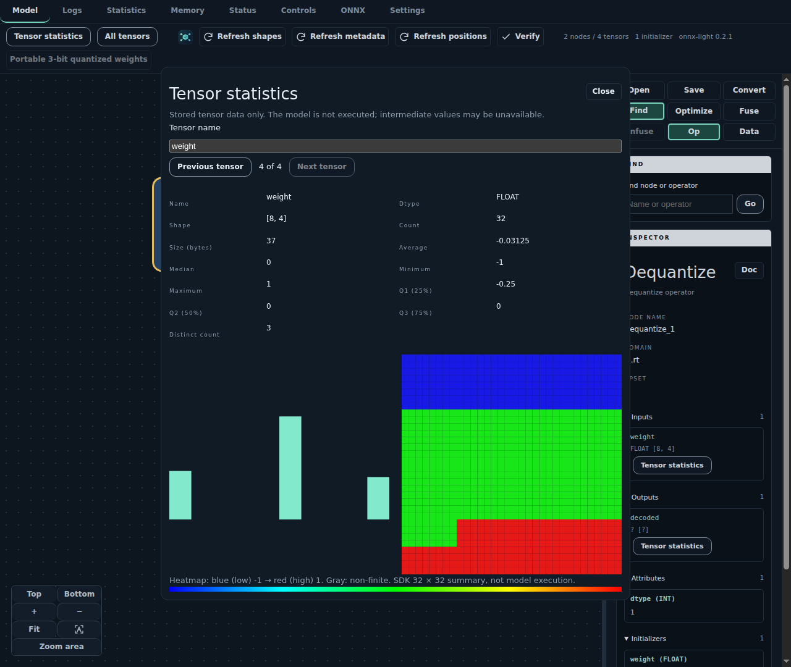

   Statistics describe stored values, without executing the graph.

Stored tensor distributions
^^^^^^^^^^^^^^^^^^^^^^^^^^^

The **Tensors** tab groups stored weights and constants by type and shape,
showing tensor counts, elements and theoretical logical bytes. Dense, sparse
and encoded values stay separate; unknown sizes remain explicit.
No payload reads, decoding or execution are needed for these totals.
See :doc:`features/inspection`.

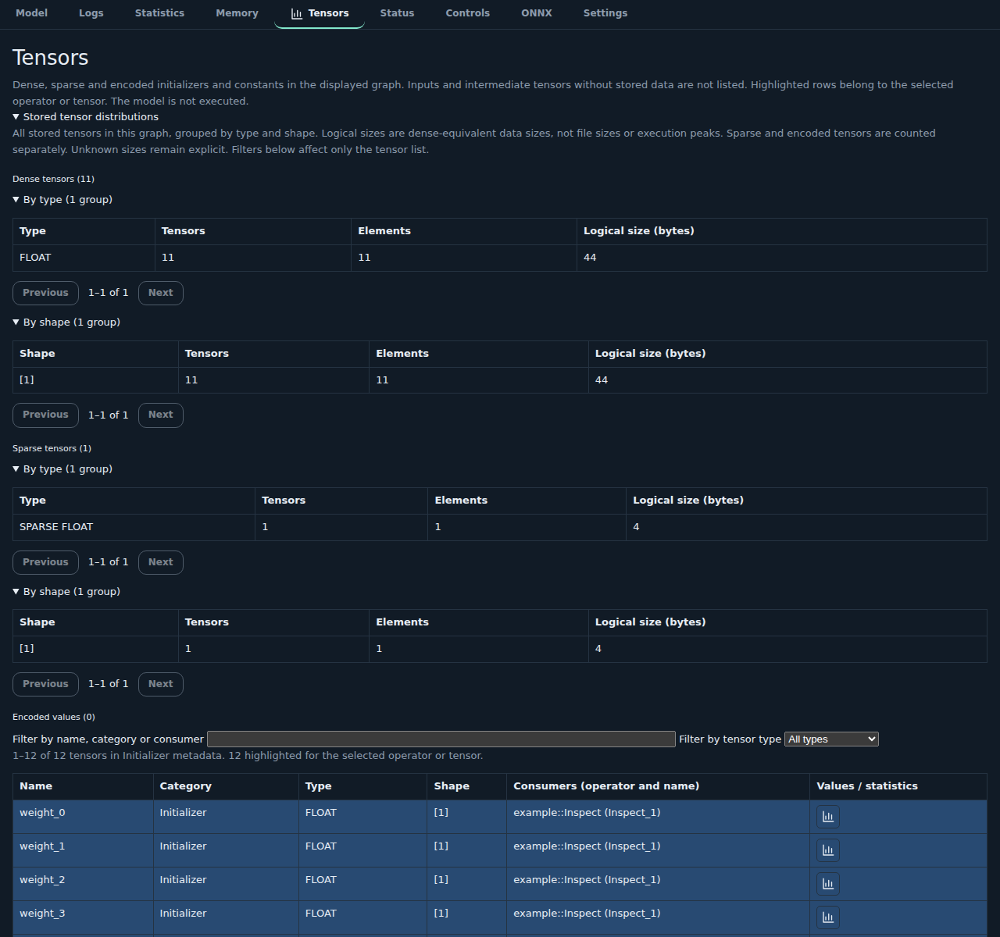

   Compare logical sizes independently of tensor-list filters.

Subgraphs and functions
^^^^^^^^^^^^^^^^^^^^^^^

Browse graph/list attributes, captured inputs, model-local function definitions
and nested graphs with breadcrumbs. See :doc:`features/subgraphs`.
Function bodies are definitions, not specialized executions of the selected call.

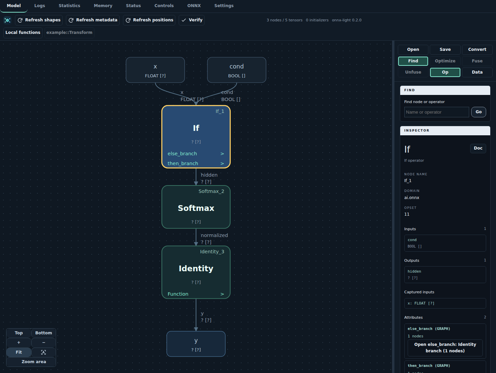

   Navigate into a model-local function definition.

PipelineProto
^^^^^^^^^^^^^

Navigate stages and generation-settings previews, run per-stage inference and
fusion, and save whole containers with embedded or external weights.
See :doc:`features/opening_models`. No pipeline execution or encryption.

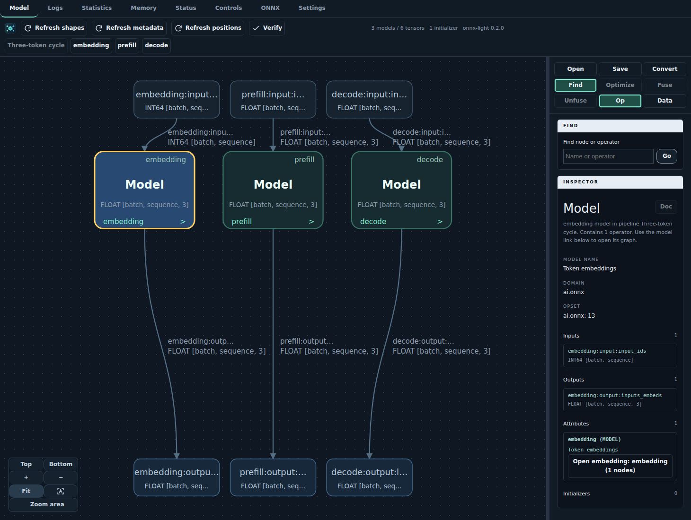

   Inspect the models contained in a pipeline.

Shape/type inference
^^^^^^^^^^^^^^^^^^^^

Choose **Refresh shapes** for visible update counts and refreshed labels without
resetting the camera or selection. See :doc:`features/inspection`.
In-memory only; unsupported operators may fail.

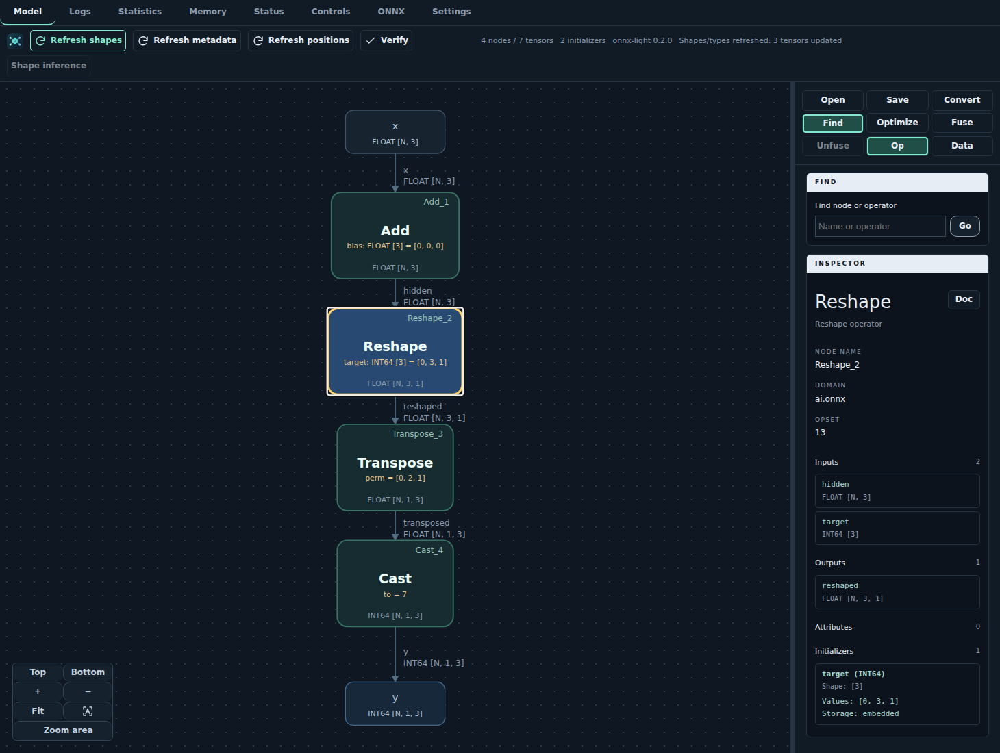

   Refresh inferred shapes without modifying the source file.

Static metadata
^^^^^^^^^^^^^^^

Inspect constants, tags, lifetimes, last reads, releasable/unused outputs and
stored model/graph/node/tensor metadata. See :doc:`features/metadata`.
This is static analysis, not measured runtime memory usage.

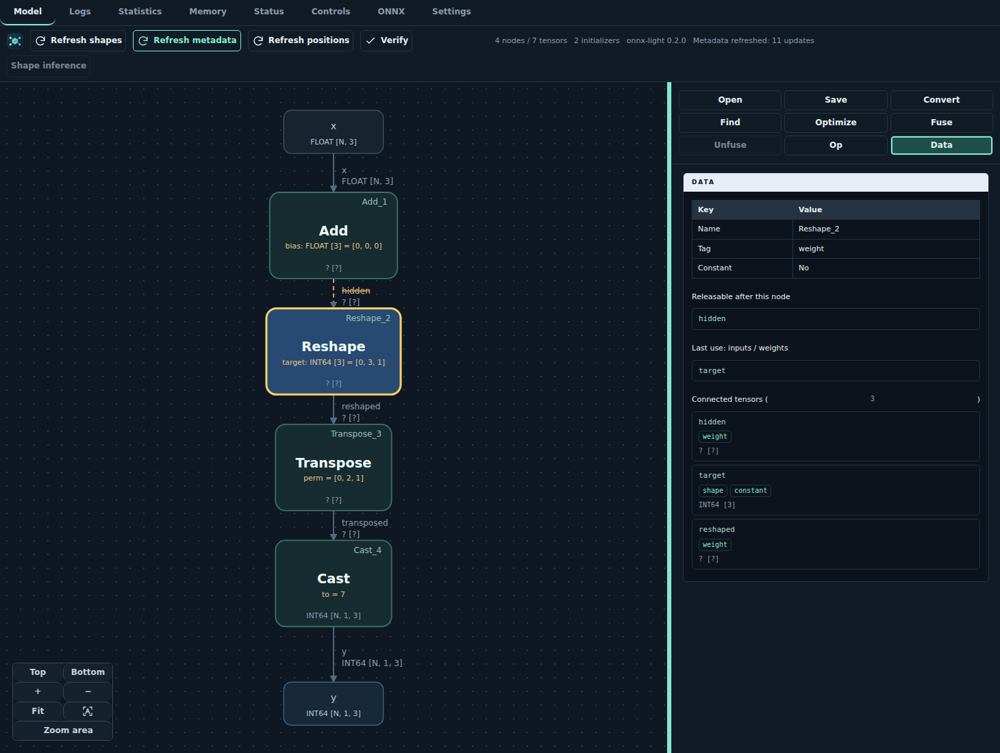

   Inspect native metadata alongside operator details.

Statistics
^^^^^^^^^^

Open **Statistics** to refresh complete-model counts, operator/type distributions
and referenced file sizes, independently of nested navigation.

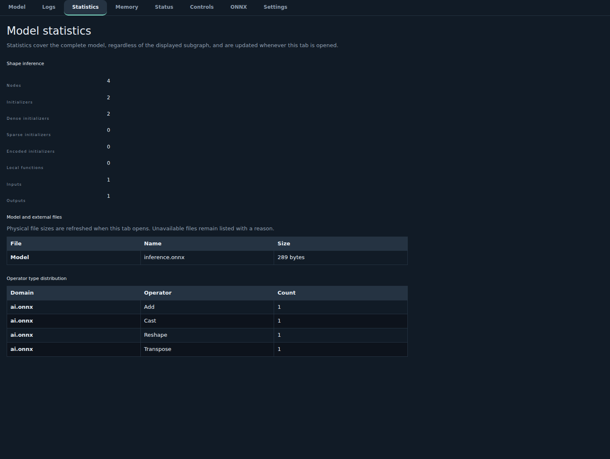

   Review the complete model rather than just the displayed subgraph.

Memory profiling
^^^^^^^^^^^^^^^^

Set dynamic dimensions and view the estimated CPU memory curve with paginated
per-node allocation/scratch events. Zoom for more operator labels and hover for
numerical and symbolic allocation details. See :doc:`features/memory_profiling`.
Native estimation, not model execution or measured RAM/GPU usage.

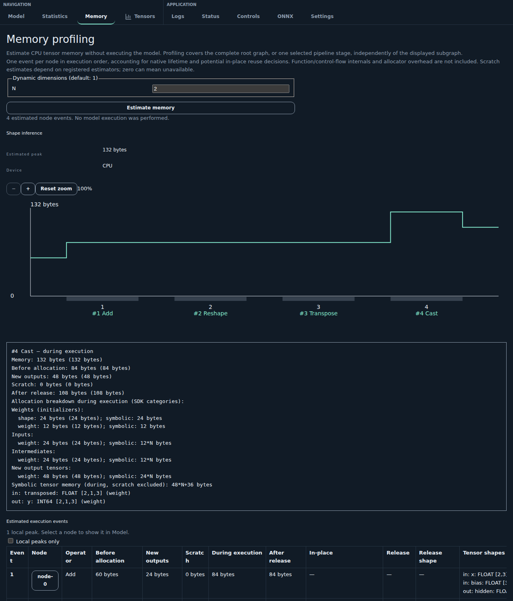

   Estimate memory for concrete input dimensions without executing the model.

Optimizer backends
^^^^^^^^^^^^^^^^^^

In **Optimize**, choose **onnx-light** for native pattern selection or
**onnxscript** for Python optimization and fusion. ONNX Script requires a
trusted workspace and ``onnx`` and ``onnxscript`` in the configured Python
environment. Both operate on the current in-memory model, not the source file.
ONNX Script output appears below **Run global optimization** after completion,
including node and ``Identity`` counts before and after each stage.
Changed Python results cannot be unfused and clear earlier native undo history.
See :doc:`features/fusion_patterns`.

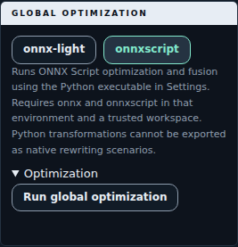

   Read Python output without leaving Optimize.

With **onnx-light**, inspect **Matched patterns**, undo the last operation or
choose **Back to original model** without leaving Optimize.

Pattern groups
^^^^^^^^^^^^^^

Combine **Default**, ``L1``, ``L2``, ``Layer``, ``onnx-light-cpu`` or **All** in **Fuse**
or **Optimize**, even when their members overlap, then refine individual patterns.
Fuse selects only graph-applicable members; Optimize starts with **Default**
and leaves the opt-in ``RepeatedLayer`` unchecked. **All** includes it.
See :doc:`features/fusion_patterns`.
Choosing groups alone does not transform or save the model.

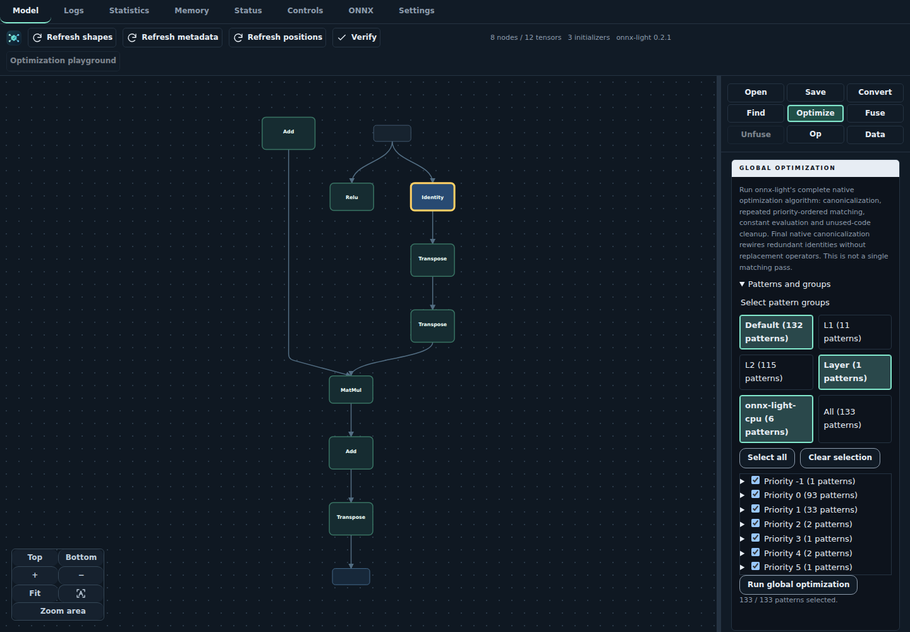

   Named pattern sets are separate from optimization priorities.

Native fusion matching
^^^^^^^^^^^^^^^^^^^^^^

In **Fuse**, select patterns and click **Run Matching**. Inspect the **Before**
and **After** candidates, check compatible matches, then click **Fuse selected**.
Previewing does not modify the graph. See :doc:`features/fusion_patterns`.

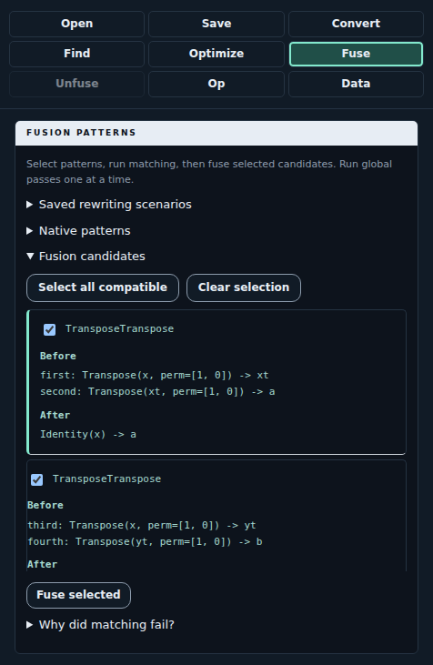

   Inspect and select native matches before applying them.

Unfuse (undo native edits)
^^^^^^^^^^^^^^^^^^^^^^^^^^^^

Open **Unfuse**, beside **Fuse** in the **Optimization** sidebar group, to undo
native edits without changing the source file. **Unfuse last** reverses one
complete operation: a batch of selected matches, a global optimization, a
global pass or an applied rewriting-scenario step/batch. Repeat to go back
further, or choose **Unfuse all** to undo all available operations, including
those on other pipeline stages.
The history lists operations newest first; click a match to highlight its
surviving result nodes. These controls are disabled when no undo history remains.
See :ref:`unfuse` for history and saved rewriting-plan details.

The native **Optimize** panel also offers **Unfuse last** and
**Back to original model** (undo all). Changed ONNX Script results cannot be
undone and clear earlier native history; later native edits undo back to that
Python result. Saving does not persist the session's undo stack.

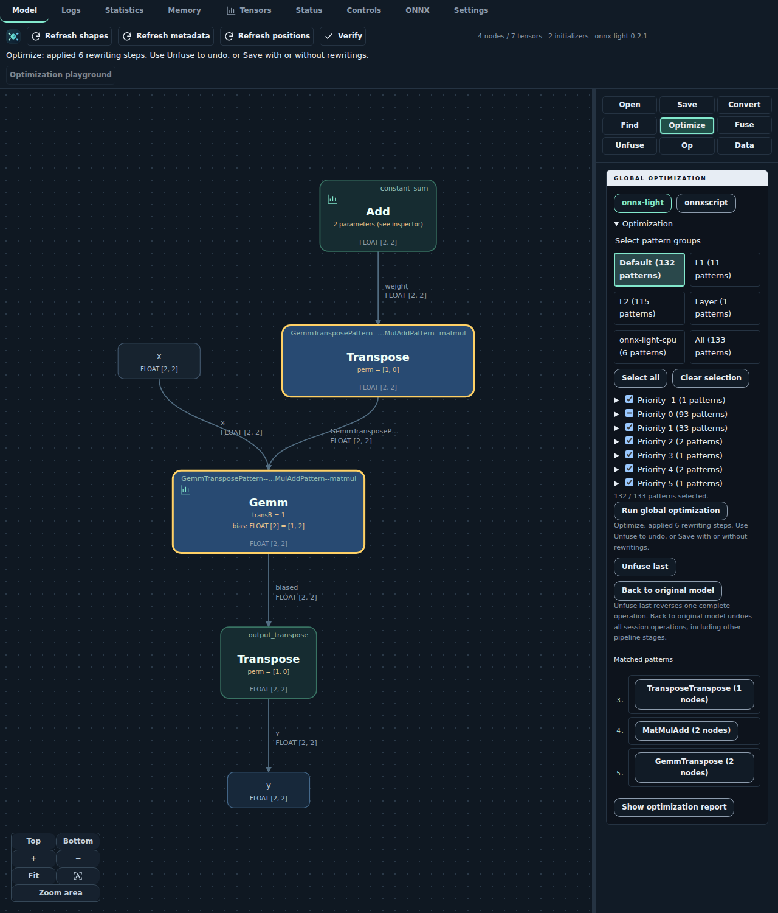

   Undo one native operation or all available native edits from Optimize.

Diagnostics and help
^^^^^^^^^^^^^^^^^^^^

View action history, progress/errors, native-library status, recovery after caught
exceptions, keyboard/mouse controls and ONNX repository links.
See :doc:`features/action_logs`, :doc:`features/navigation` and :doc:`links`.

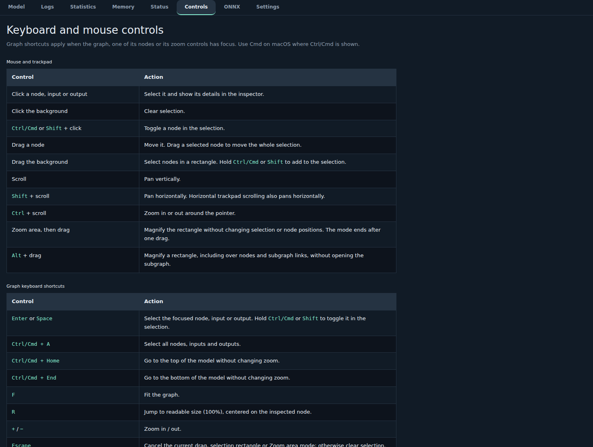

   Find the navigation and selection controls.

Not yet available
-----------------

The following are not implemented features of the default branch. A capability
in onnx-light, onnx-light-cpu or ONNX Runtime does not imply a corresponding
viewer control.

.. list-table::
   :header-rows: 1
   :widths: 35 65

   * - Capability
     - Status
   * - Model saving and encrypted ModelProto I/O
     - In progress in `PR #115
       <https://github.com/xadupre/onnx-light-viewer/pull/115>`_, including embedded
       and plain external-weight export. Not available on ``main`` yet.
   * - Other graph transformations
     - Planned: weight quantization and rewriting
       scenarios/pipelines.
   * - Full tensor analytics
     - Planned: statistics, histograms, color maps and decoded payload browsing.
       Opaque/structured type and encoded layout previews are already available.
   * - Execution and benchmarking
     - Planned: whole-model/subgraph execution, CPU/CUDA engine comparison and
       input/output export with reproducible execution scripts.

Detailed guides
---------------

.. toctree::
   :maxdepth: 1

   features/opening_models
   features/exporting_models
   features/navigation
   features/inspection
   features/subgraphs
   features/metadata
   features/memory_profiling
   features/fusion_patterns
   features/backend_tests
   features/action_logs
