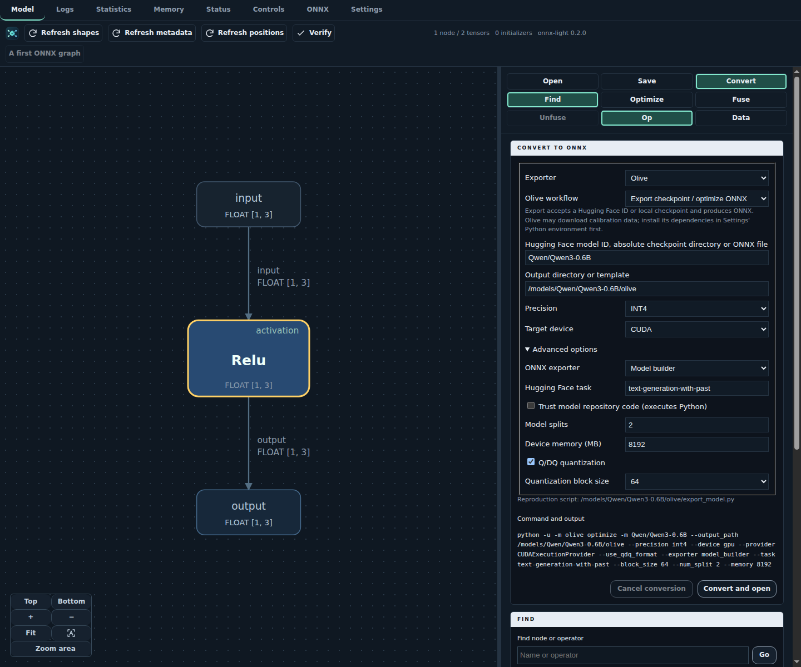
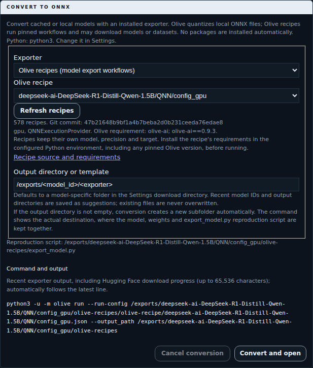
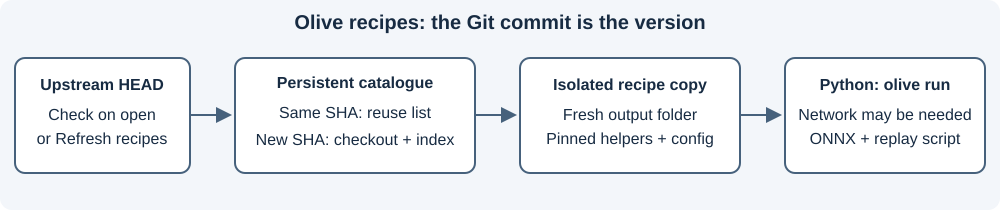

Converting models
=================

Choose **Convert** to export checkpoints with mbext, modelbuilder, Mobius or
**Olive**, quantize an existing ONNX file, or run an **Olive recipes** workflow.
Model IDs are downloaded into the source cache first. Olive optimization and
recipes may also download calibration data during conversion.
**Download time** and **Conversion time** are shown separately at the top of the
panel, update while running and remain visible after success, failure or cancellation.

         A Python exporter reads that snapshot and saves ONNX files.
         The viewer opens the result without executing it.
   :width: 100%

   Conversion is a separate process; inspection never executes the exported graph.

1. Trust the VS Code workspace and select your Python executable in **Settings**.
   Install the desired exporter and its dependencies in that environment yourself.
   The viewer neither installs packages nor changes ``PYTHONPATH``.
2. Open **Convert** and select the exporter. Enter a Hugging Face model ID or an
   absolute local checkpoint-directory path. Olive also accepts local ONNX files.
   The last used exporter is restored
   across sessions. ``mbext (fast export)`` appears last in the list.
   Choose precision and CPU/CUDA target.
3. The output defaults to ``<download directory>/<model_id>/<exporter>``, using
   the download directory configured in **Settings**. The editable template is
   kept in the field; the command shows the expanded path.
   The download directory is created automatically
   when settings are loaded or saved. Edit the output field to choose another absolute
   **output directory**. If it is not empty, conversion creates a fresh subfolder,
   such as ``modelbuilder-ABC123``, without touching the existing files.
   The displayed command, reproduction script and history use that actual destination.
   Recent model IDs and output directories
   are saved across sessions and suggested in their respective fields.
   Suggestions only fill the field; existing files are never overwritten.
   Review the displayed command, then choose **Convert and open**.
4. For remote checkpoints, the application downloads the source, then converts it.
   Separate clocks measure these phases, excluding model selection and opening.
   The output window shows live standard output/error and download progress,
   and scrolls automatically to the latest line.
   The subprocess enables progress bars even without a terminal; terminal control
   sequences are removed and carriage-return updates appear as readable lines.
   **Cancel conversion** stops the
   active download or exporter process; closing the viewer also stops it.
   Cached sources and generated files remain available.

After a successful process exit, the viewer opens the exported ``.onnx`` or
``.pipe-onnx`` file. If several models were produced, choose which one to open.
Failures leave the previously displayed model unchanged and appear in the panel
and **Logs**. You can retry immediately, without dismissing the error notification.
Moving to another model while export is running prevents automatic
replacement; the saved files remain available.

Olive and Olive recipes
-----------------------

Both use the ``olive-ai`` Python package (``python -m olive``), but have distinct
controls:

* **Olive:** defaults to **Export checkpoint /
  optimize ONNX**. Enter a Hugging Face ID (for example
  ``Qwen/Qwen3-0.6B``), an absolute local checkpoint directory or an ONNX file.
  Select **FP32**, **FP16**, **BF16**, **INT4** or **INT8**, and **CPU** or **CUDA**.
  The viewer invokes ``olive optimize``; Olive selects its optimization passes
  and reports unsupported model/device combinations.
* **Advanced options** exposes Olive's ONNX exporter (model builder, PyTorch
  Dynamo or TorchScript), Hugging Face task, model splits, device memory in MB,
  Q/DQ encoding and INT4 block size. Unset fields keep Olive's defaults.
  **Trust model repository code** explicitly permits executing custom Python
  from the model repository; its files are downloaded at the same pinned revision.
* To retain the local-only quantizer, select **Quantize existing ONNX (CPU,
  offline)**. Supply an absolute ``.onnx`` file and choose **INT4** (Olive RTN)
  or **INT8** (ONNX Runtime dynamic). Q/DQ encoding is optional. This mode needs
  no calibration dataset.
* **Olive recipes (model export workflows):** choose a catalogued recipe.
  The recipe keeps its own model, precision and target. Install the requirements
  linked beside it in the configured Python environment first. Version-pinned
  recipes remain listed, with their ``olive-ai`` requirement shown explicitly;
  the viewer never upgrades packages or hides recipes based on the installed version.

   Export a checkpoint directly; an existing ONNX file is not required.

Olive optimization is not forced offline: selected passes may fetch calibration
datasets or other resources even when the checkpoint is local. Install the
dependencies required by Olive and the chosen ONNX exporter yourself.
The equivalent direct CLI invocation is:

.. code-block:: bash

   python -m olive optimize -m Qwen/Qwen3-0.6B \
       --output_path /path/to/new-export --precision fp32 \
       --device cpu --provider CPUExecutionProvider

The viewer first caches the pinned checkpoint, then substitutes its absolute
snapshot directory for the model ID in this command.

   Review the pinned recipe and its package requirements before running it.

Git must be available on ``PATH``. Opening the recipe list or choosing
**Refresh recipes** checks the upstream repository's ``HEAD`` commit. An unchanged
commit reuses the saved model list; a new commit creates a new immutable checkout
and catalogue under ``<download directory>/olive-recipes/<commit>``.
Checkout/network failures are displayed, not silently replaced by another version.
The catalogue reads upstream ``info.yml`` / ``info.yaml`` entries, including
requirements inherited from parent directories.

         otherwise index a new checkout. Run a selected JSON workflow from an
         isolated copy, leaving cached snapshots and previous output untouched.
   :width: 100%

   The selected Git commit stays pinned throughout a conversion.

JSON workflows run with ``olive run --run-config ... --output_path ...``.
The viewer copies the pinned repository into the fresh output's ``olive-recipe``
folder so relative helper paths work without modifying the shared cache.
The reproduction script preserves that working directory and records the commit.
Recipes can download checkpoints or datasets, so their clock says **Managed by recipe**
and conversion is not forced offline. Authentication, hardware and external tools
are the recipe's prerequisites. Script-only recipes and incomplete upstream
entries stay visible with a manual-instructions notice and source link;
they are not passed to ``olive run``.
Only generated ONNX models outside the copied recipe sources are offered for opening.

Checkpoint source cache
------------------------

Sources are kept in ``<Settings download directory>/huggingface``, independently
of conversion output directories. Repeating a conversion or changing exporters
reuses downloaded weights. The application resolves the repository's current
commit before downloading and converts that pinned local snapshot.

The selected Python environment must provide ``huggingface_hub``.
Downloads prefer the standard root safetensors checkpoint, including its
indexed shards, and otherwise use the standard PyTorch checkpoint. Tokenizer
and configuration files are included; alternative weight formats and precision
variants are not downloaded. For repositories with a custom layout, provide
an absolute local checkpoint directory instead.

Local sources skip downloading. mbext, modelbuilder and Mobius use local exporter
arguments (``-i`` or Mobius ``--config``) with ``HF_HUB_OFFLINE=1`` and
``TRANSFORMERS_OFFLINE=1``: a missing dependency or file fails explicitly rather
than silently downloading during conversion. Olive optimization receives the
same local snapshot through ``-m`` without forced offline mode.

Output directory templates
--------------------------

Use ``base/<model_id>/<exporter>`` to group conversions by model and tool.
Relative paths start in the configured download directory; absolute templates
are also supported. For model ``Qwen/Qwen3-0.6B`` with modelbuilder, this becomes
``<download directory>/base/Qwen/Qwen3-0.6B/modelbuilder``.
``<exporter>`` expands to ``modelbuilder``, ``mobius``, ``mbext``, ``olive`` or
``olive-recipes``, not its display label. For a local checkpoint, ``<model_id>``
is its directory name; for a local ONNX file it is the filename, and for recipes the
recipe name.
Unsupported placeholders and model IDs containing unsafe path components are
reported as errors.

The command preview uses the expanded path without changing the editable
template. History retains both the template and the actual destination, including
any fresh subfolder created for an existing conversion.

Reproducing a conversion
------------------------

The chosen folder contains ``export_model.py`` alongside the export package.
It replays the same argument vector, Python executable, working directory and
progress settings (``HF_HUB_DISABLE_PROGRESS_BARS=0``, ``TQDM_POSITION=-1``)
and, for mbext, modelbuilder, Mobius and local-only quantization, offline settings
without a shell. Run it with Python to reproduce the export; unlike the viewer's
fresh-directory check, subsequent CLI behavior is controlled by the exporter.
Checkpoint reproduction reads the same cached local snapshot without repeating
the source download; recipes can perform their own downloads.
The live output retains its most recent 65,536 characters rather than growing
indefinitely. The command display quotes arguments only when shell syntax requires
it; execution always passes the argument vector directly, without a shell.

Exporter entry points
---------------------

mbext is distributed as ``modelbuilder``; Mobius as ``mobius-onnx``.
The upstream modelbuilder module is included with ``onnxruntime-genai``.
Olive and Olive recipes both require ``olive-ai``; use a version supporting
the commands below, or the recipe's declared version. Older CLI contracts are
not detected or rewritten.

.. list-table::
   :header-rows: 1

   * - Selection
     - Python module
   * - mbext
     - ``modelbuilder.builder``
   * - modelbuilder (ONNX Runtime GenAI)
     - ``onnxruntime_genai.models.builder``
   * - Mobius
     - ``mobius build``
   * - Olive
     - ``olive optimize`` (default) or ``olive quantize`` (local-only mode)
   * - Olive recipes
     - ``olive run``

For INT4 advanced options, modelbuilder uses ``block_size`` and ``algo_config``;
mbext retains ``int4_block_size`` and ``int4_algo_config``. Modelbuilder requires
the `updated upstream CLI contract
<https://github.com/microsoft/onnxruntime-genai/blob/6b7ff3ca3efa15da219050fdb4ecf8bed67875af/src/python/py/models/README.md#quantization-options>`_.
Older modelbuilder versions accepting only the prefixed names must be upgraded
to use these two settings; the viewer does not detect or fall back to legacy names.
Default commands are unchanged when these settings are left unset.

FP32, FP16, BF16, INT4, INT2 and FP4 are selectable for the three checkpoint
exporters and both CPU/CUDA targets. The viewer does not filter combinations or reset the selected
precision; the exporter reports unsupported values through its normal CLI errors.
Mobius receives ``f32``/``f16`` for FP32/FP16; other precision names are passed
unchanged.
Model support, authentication, runtime compatibility and additional restrictions
depend on the installed exporter. Downloads use the selected Python environment and
credentials; the viewer does not request tokens or enable remote checkpoint code.
