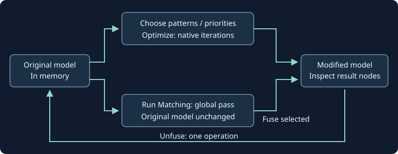
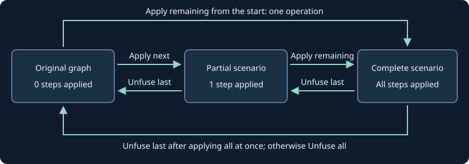
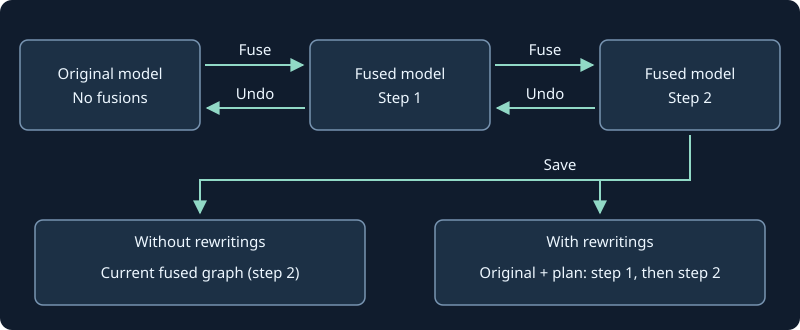

Fusion patterns
===============

**Fuse**, at the top of the right sidebar, opens the native onnx-light pattern
matcher on the main graph.
The list keeps patterns whose anchor operator occurs in that graph, plus patterns
without an anchor restriction. Manual matching does not run model inference.
Return to the main graph's breadcrumb to enable this control.
The available native patterns are displayed in the sidebar; select one or more
names with normal clicks, then click **Run Matching** while keeping
the main graph visible. This button belongs to the **Native patterns** section.
Every click reruns matching from scratch for the selected
patterns and clears the previous candidates and selection.
Click a pattern again to uncheck it. **Select all** checks every pattern;
**Clear selection** unchecks them all. No modifier key is needed.

.. code-block:: text

   Fuse -> Choose patterns -> Run Matching
                                        |
                         +--------------+--------------+
                         |                             |
                  Click candidate             Inspect replacements
                         |                             |
                         +--------------+--------------+
                                        |
                     Check candidates -> Fuse selected
                                        |
                                   Save a copy

Each candidate shows its pattern followed by **Before** and **After** sections.
Before lists the affected nodes by name; After lists their replacement operators.
Both show input/output tensor names and inline attributes, so parallel nodes
sharing an input are not mistaken for a chain. Clicking a candidate selects its
nodes in the main graph for inspection. Check or uncheck candidates to choose
which ones to fuse; inspecting or checking a candidate does not change the model.
Both patterns and candidates use collapsible, scrollable lists with checkboxes.
The list includes overlapping matches. A darker background marks each candidate
sharing a node with any earlier candidate, regardless of which ones are checked.
Hover over a darker entry for an explanation; graph highlighting is unchanged.

Check individual candidates or choose **Select all compatible**, then click
**Fuse selected**. Candidates from different patterns can be fused together.
The **Fuse selected** button is inside **Fusion candidates**.
**Clear selection** in the candidate list unchecks all candidates without
changing the model.
Overlapping matches
cannot be applied together; the selection count and next step are shown.
Clicking **Fuse** again hides the panel and discards the preview
and selection without applying anything, including while matching is running.
All fusions change only the in-memory model; use **Save** to keep the result.
After **Fuse selected**, the panel stays open with the native pattern list
refreshed against the new operators. Select patterns and run matching again to
find further fusions; obsolete candidates are discarded.
Graph replacement or navigation invalidates the preview.

Why does a pattern not match?
-----------------------------

If **Run Matching** finds no candidates, its message points to
**Why did matching fail?**, at the end of **Fuse**.
Select the operator where you expected a match,
choose one of the native patterns checked in **Native patterns**, then click
**Explain failed match** to see the rejection reason.
The dropdown contains only those checked patterns, not the whole catalog.
Only this pattern/node pair is inspected; no rewrite is applied.

The result explicitly says whether the pattern does not match and why,
cannot match the operator type (``FastOpType()``), matches after all,
or supplies no rejection reason.
**Native source location** directly shows a clickable URL to the source file
and line in the bundled onnx-light release; there is no extra disclosure to open.
Changing the selected node, checked patterns or diagnostic pattern, closing Fuse,
navigating or replacing the model discards pending results and errors.
Global cleanup passes are not individual-node patterns and use their existing
whole-graph preview instead.

Iterative optimization and global passes
----------------------------------------

**Optimize** has its own sidebar panel, separate from **Fuse**.
It opens the full native catalog, including patterns whose operators
are not present yet. Select individual patterns, whole **Priority** groups,
or **Select all**, then click **Run global optimization**.
Groups use onnx-light's native priority metadata, not inferred categories.
This runs onnx-light's complete native optimizer, not a single pattern batch:
native canonicalization, repeated priority-ordered matching, evaluation of
constant replacements and unused-code cleanup.
A replacement can enable another pattern in a later iteration.
Final native canonicalization removes redundant identities by rewiring consumers,
without inserting replacement Identity operators.

After each run, click **Show optimization report** to open a wide dialog outside
the sidebar. Its tables show iteration and rewrite counters, elapsed and phase
timings in milliseconds, per-pattern attempts and accepted matches, rejection reasons with
occurrence counts and native source locations, and nested-graph statistics.
Source locations link to the corresponding release file and line on GitHub.
The dialog opens only when requested; **Close** or Escape returns to the graph.
The report is also available after a no-op run and when reopening Optimize.
Counters include nested graphs; phase timings marked **root** exclude them.
Subgraph rows include their descendants and must not be summed.
**Full native operation elapsed** is independently measured with a monotonic
clock, from native worker construction until its result is ready. It includes
preparation, worker queueing, optimization and final canonicalization.
**Total native phase time** covers only the instrumented optimizer phases.
Neither includes graph transfer or rendering; these are not end-to-end UI timings.
Reports belong to the current in-memory snapshot or pipeline stage.
Unfuse restores the preceding snapshot's report; applying another rewrite
clears it. Reports are not saved into ONNX files.

   Global optimization is separate; individual passes use the pattern workflow.

In **Fuse → Native patterns**, ``IdentityRemoval``, ``ConstantFolding`` and
``RemoveUnusedNodes`` use the same **Run Matching → Fusion candidates →
Fuse selected** workflow as other patterns.
Candidates show affected operators and rewired consumers, not synthetic
replacement identities. Constant folding evaluates constant expressions with
native kernels, not model inputs. Unused-code removal also removes unused weights.
An initializer-only change can have no root operators to highlight.
Each global pass is a whole-scope candidate and must be applied individually;
no-op passes produce no candidates.
Closing Fuse, navigating or replacing the graph discards previews.

Each optimization or applied pass is one **Unfuse** operation.
Applied patterns are listed in the optimization results and in **Unfuse**;
click an entry to highlight its surviving result nodes. Folding a node entirely
into an initializer leaves no operator to select.
**Save → Include fusion rewritings** works for these operations too:
unchecked saves the optimized graph; checked saves the original and its
replayable plan, including any initializer-preparation functions.
Pipeline stages are optimized independently. Existing local function bodies
are preserved; transformations apply to model graphs and nested graph attributes.

Open :download:`optimization.onnx <../../examples/optimization.onnx>` to try
all three passes and iterative fusion on an eight-node model, including
an unused ``Relu`` branch.
The ``MatMulAdd`` replacement enables ``GemmTranspose``, which has no anchor
in the original graph. Regenerate the example with
``node examples/generate_optimization.cjs``; no Python dependency is required.

Saved rewriting scenarios
-------------------------

**Fuse → Saved rewriting scenarios** lists named ``RewritingProto`` variants
stored in the model. This section starts collapsed when the model has none.
Select a scenario to inspect its ordered patterns and
progress, then choose **Apply next pattern** or **Apply remaining scenario**.
The latter applies every remaining step as one operation. Each click can be
reversed with **Unfuse last**; **Unfuse all** restores the original model.
In a pipeline, open a stage's main graph to choose that stage's scenarios.
Click the next pattern to highlight its matched nodes. **Apply next pattern**
automatically highlights the following step's nodes in the updated graph.
Applied steps select their surviving result nodes; later steps become
inspectable when their preceding steps have been applied.

Open :download:`rewriting-scenarios.onnx <../../examples/rewriting-scenarios.onnx>`
for a ready-to-use model containing the ``onnx-light-viewer.fusions`` scenario
with two successive ``TransposeTranspose`` steps. No manual fusion or save is
needed before trying the scenario controls. To regenerate it after compiling
the extension, run ``node examples/generate_rewritings.cjs`` with Node.js 22.

   Next applies one stored edit; remaining applies a batch with one undo boundary.

Scenarios are alternatives against the original graph, not successive variants.
Unfuse existing edits before switching scenarios. Manual fusion after a scenario
also pauses scenario playback until that manual operation is undone.
Each step is replayed from the original graph with its complete preceding prefix,
so intermediate node reordering cannot change the meaning of stored indices.
Structural edits, such as ``Finalize fusion node order``, appear as steps too.
Subgraph edits display their stored scope path; their history entries do not
select nodes in the main graph.

Undo and rewriting plans
-------------------------

**Unfuse**, beside **Fuse**, offers **Unfuse last** and **Unfuse all**.
Unfuse last restores the model before the last fusion or scenario operation:
one step reverses all candidates, optimization iterations or global-pass edits
applied together. The choices remain open so
you can repeat Unfuse last to undo earlier operations, including operations on
different pipeline stages. Unfuse all reverses every remaining operation at once.
Below the buttons, each applied match is listed separately, even when several
matches use the same pattern. Operation headings retain the undo order, newest
first, with pipeline stage names. The first operation is the next one that
Unfuse last will undo; each undo removes its entries.
Click a match to select only its resulting nodes in the graph, opening the appropriate
pipeline stage when necessary. After further fusions, selection follows the
surviving replacement nodes rather than stale node positions. Patterns with no
remaining nodes cannot be selected.
Undo returns to the current model's root graph and clears cached metadata.
Opening another file starts a new history; previewing and saving do not add steps.
Native recovery preserves the history.

   Undo history is session-local. Rewriting plans are optional saved variants.

In **Save**, **Include fusion rewritings** selects the saved representation:

.. list-table::
   :header-rows: 1
   :widths: 25 75

   * - Choice
     - Saved content
   * - Unchecked (default)
     - Current fused graph, without ``RewritingProto`` variants.
   * - Checked
     - Original graph plus one named ``onnx-light-viewer.fusions`` plan,
       concatenating the remaining Fuse operations in application order.
       Existing named variants are retained without overwriting their names.

The checked form follows onnx-light's canonical-model/variant contract:
reopening it displays the original graph; choose the saved scenario in **Fuse**
to replay it. It does not persist the viewer's Undo stack.
For pipelines, each modified stage stores its own original graph and ordered
plan. The choice also applies to encrypted saves and external-weight storage.

For example, two inverse transposes can be replaced with an identity:

.. code-block:: text

   Before: x -> Transpose(perm=[1,0]) -> Transpose(perm=[1,0]) -> y
   After:  x ---------------------> Identity -----------------> y

Save and weights
----------------

Use **Save** to write a different model file. The original model and its source
weight files are protected from overwriting.

.. list-table::
   :header-rows: 1
   :widths: 30 70

   * - Choice
     - Result
   * - Embedded weights
     - A self-contained plain or password-encrypted model.
   * - External weights
     - A plain model and fresh weight files; choose their maximum size.
   * - Reuse unchanged external files
     - A plain model referencing the original external weights; only new or
       modified payloads need saving. Save beside the source model so relative
       paths, offsets and lengths remain valid.

The default chunk size is **5120 MiB (5 GiB)**. A tensor cannot span chunks;
small tensors may stay embedded. Weights originally embedded in the source
cannot be reused as external files and are saved normally. Reused external
files must remain available and unchanged: the viewer checks their content when
saving. To move the result elsewhere, choose embedded weights or a full external
copy instead. Separate encrypted external files are not supported upstream.

Fusion materializes the model's weights in native memory before matching, unlike
ordinary lightweight inspection. Large models therefore require enough memory
for their tensor payloads and the pattern's intermediate data.
