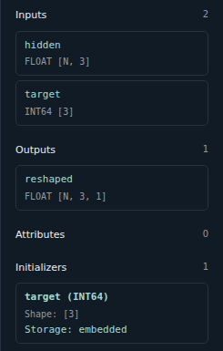

Operator and tensor inspection
==============================

The buttons **Op**, **Data**, **Find** and **Fuse** at the top of the right sidebar
show or hide their panels independently. Visible panels stack vertically,
with **Find** above **Op**, each in a separate bordered box. **Op** contains
operator and tensor details, **Data** contains metadata and lifetime analysis, **Find** searches nodes,
and **Fuse** manages fusion patterns. **Op** and **Find** are initially visible.
The sidebar includes **Open**, **Save** and **Convert** alongside the inspection
and optimization controls. **Convert** runs a separate installed Python exporter;
see :doc:`exporting_models`.
**Open** and **Save** toggle their own sidebar panels for file selection and
save options; opening either hides the other. **Open** offers optional path
pickers directly below **Model path**; **Save** keeps its inline folder browser.
All sidebar panels have an inverted-color title bar using the compact uppercase
**INSPECTOR** typography.

The right sidebar starts at 300 pixels wide and can be resized by dragging its
divider. Its width and the visibility of **Op**, **Find** and **Data** are saved
automatically in VS Code's user-directory extension storage and restored on
reopening, including after closing the application. Passwords and model data are
not included in these preferences.

Select a node to see its name, domain, imported opset, inputs, outputs and typed
attributes. Scalar and list values appear below the name/type heading without
repeating the attribute name. Schema defaults are marked ``[default]``; long
attribute arrays show a bounded preview.

Click the background to inspect the current **Model**, **Graph**, **Function** or
**Pipeline** instead of an operator. The inspector shows its name and ports.
It also lists every imported domain and opset version, including unused imports.
Model and graph scopes also list their **Initializers**, **Sparse initializers**
and **Encoded initializers** separately, with counts, types, shapes and storage
details. These lists include unused initializers declared in the current graph,
not weights captured from a parent graph. For pipelines, open a model's graph
to inspect its initializers.
Functions show their own imports; a pipeline overview combines the imports of
its models, preserving different versions of the same domain.

Use **Verify**, next to the refresh buttons, to run onnx-light's ``VerifyModel``
on the entire model, including when viewing a subgraph or function. For pipelines,
every contained model is checked. The toolbar displays success or the verification
error, also recorded in **Logs**. Verification does not infer shapes, execute
operators or change the model.

Operator names sit at the top right of each box. Attributes and connected
initializer previews are centered below the type in a contrasting color when there are
at most two and each fits on one line of up to 38 characters. Otherwise, a
parameter count points to the inspector. Subgraph attributes keep their navigation
links instead of appearing in this count. Schema defaults remain in the inspector.

Graph labels and the inspector show declared tensor types and dimensions,
including symbolic dimensions, scalars and unknown shapes. Dense and sparse
initializers show type, shape and embedded/external storage information,
including external filenames. Dense embedded initializers with fewer than 16
elements also show their available values in the inspector and, when short enough,
inside the operator box. Scalars count as one element; 64-bit integers retain their exact precision.
Sparse previews label stored values and indices separately when each component
has fewer than 16 elements, regardless of the logical dense shape. Individual
strings are limited to 128 bytes, with an ellipsis for truncation. External files
and payloads omitted during loading are never read for a preview. The initializer
list scrolls without limiting the number of connected parameters.

Opaque and encoded values
-------------------------

Opaque ports show their domain/name; structured ports show their declared layout,
including model-scoped type references. These are ``TypeProto.Opaque`` and
``StructTypeProto`` in onnx-light, rather than ordinary tensor types.
``EncodedValueProto`` initializers appear in the connected parameter list with
their logical type/shape when present, an **Encoding** layout preview and
embedded/external storage. Affine and structured layouts are supported.
Logical types and encoding layouts are shown as **Field**, **Type / description**
and **Value** tables rather than serialized objects. Each field occupies one row,
with its shape next to its type instead of on a separate row.
Zero-sized shapes such as ``[0]`` are valid and have no values; scalars ``[]``
still have one value.
Tables and nested structures start folded. Unfold each table with its heading,
and nested structures with their **+** / **-** buttons.
Nested field paths identify array elements,
bit widths and layout constants; model-scoped type references are resolved.
Small constants use the same bounded previews as ordinary initializers.
For inline payloads, **Value** also previews the actual stored fields: scales,
zero points, offsets, codebooks, packed codes and bit-packing components.
Inspection shows the first record, up to eight elements of each structured array,
and up to fifteen values per numeric field. Larger previews are marked explicitly.
External files are not opened; unavailable or malformed payloads show a reason.
Recursive references, missing declarations and display limits are identified
explicitly instead of expanding indefinitely.
This reads the physical layout only: it does not run decoder functions or
dequantize packed bytes into logical model weights.

Open ``examples/quantized-2bit.onnx`` or ``examples/quantized-3bit.onnx`` and select
**Dequantize** to inspect portable Q2_K/Q3_K weight layouts. The 2-bit example
uses an inline declaration; the 3-bit example uses a model-scoped type reference.
These are onnx-light extensions, not standard ONNX or GGUF storage formats.
With onnx-light 0.2.1 Python bindings and their dependencies available, regenerate
both examples from the repository root:

.. code-block:: sh

   python examples/generate_quantized.py

Stored tensor distributions
---------------------------

Open **Tensors** to group stored weights and constants by type or shape.
Each group shows its tensor count, element count and theoretical logical size
in bytes, calculated by onnx-light from metadata alone. No payloads are read
or decoded for these distributions, and the graph is not executed.

Dense tensors, sparse tensors and encoded values have separate tables.
Sparse and encoded sizes are dense-equivalent logical data sizes, not compressed
storage sizes or execution peaks. Unknown shapes and variable-width byte sizes
remain explicitly unknown. Scalars ``[]`` count as one element; zero dimensions
count as zero. Each table pages through at most 100 groups at a time.

Distributions describe the current graph's stored tensor catalogue, including
consumed initializers captured from parent graphs. Tensor-list filters below
do not change these totals. Inputs and intermediate activations are excluded.

.. figure:: ../_static/feature-tensor-distributions.png
   :alt: Tensors tab grouping stored tensors by type and shape with exact element counts and logical bytes.
   :width: 100%

   Review stored tensor sizes without computing value statistics.

Tensor statistics
-----------------

Use **Tensor statistics** for the selected nodes' tensors or selected connection,
**All tensors** for the current graph scope, or **Tensor statistics** beside a tensor
in **Op**. Open a pipeline stage first. The dialog browses one tensor at a time
with a name picker and **Previous tensor** / **Next tensor**;
**Close** or Escape dismisses it.

It shows dtype, shape, count, stored byte size, mean, median, min/max and quartiles
(25%, 50%, 75%, linearly interpolated). The SDK supplies a finite-value histogram
for at least ten values and a 32 × 32 area-averaged color map. Rank-two and higher
tensors use the first dimension as rows and flatten the remaining dimensions;
scalars and vectors use one row before resizing. Blue is low, red is high and
gray is nonfinite. Hover over bars or cells for their numeric values.

Statistics run on demand in a native background worker. Unlike small previews,
this explicitly reads local external weights and restores omitted inline data
when necessary. Large tensors may require substantial decoding and sorting
memory. Low-bit numeric types and SDK-supported encoded quantized tensors use
the SDK's decoded values; ordinary integer tensors describe their stored codes,
without inferring scales from connected operators.
Sparse, string, complex and unsupported encoded layouts report unavailability.
Affine-only encoded layouts are not decoded by onnx-light 0.2.1.
Inputs and intermediate outputs without stored values also report unavailability:
the viewer never executes the graph to collect activations.

Only successful summaries are cached, up to 32 tensors in the current graph.
Opening another graph, replacing the model or refreshing shapes clears the cache.
The source model is not modified, and late responses cannot update another tensor.

Operator documentation and inference
-------------------------------------

**Doc** opens the selected operator's available onnx-light schema documentation,
with its schema version, formal inputs/outputs, attributes and type constraints.
It is disabled when no documentation is available. **Close** or Escape dismisses it.
Inputs and outputs have separate sections, with spaced parameter headings and
descriptions.
Documentation is rendered as Markdown, including headings, lists, emphasis,
inline and fenced code, tables and HTTP(S) links. Raw HTML remains visible as
text, unsafe links are not activated, and images are shown as text labels
without fetching external resources. The renderer is bundled for offline use.

**Refresh shapes** explicitly runs native shape/type inference. It updates
labels and the inspector without resetting selection, positions or the camera.
Unsupported operators or missing information can produce an error; the previous
display remains available. Opening a model does not automatically infer shapes.
