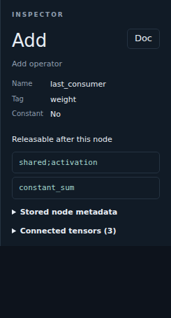

Metadata and lifetimes
======================

**Metadata** switches the inspector to native constant, tag and lifetime
analysis, alongside stored model, graph, node and connected-tensor metadata.
While open, the button stays filled, outlined and checked, independently of
its refresh-status color.
**Refresh metadata** recomputes this analysis for the displayed graph,
even with the metadata inspector closed, without changing the view.

Select an operator to see results releasable after its last reads: their
connections become dashed and tensor names are crossed out. Caller-owned inputs
and weights reaching their last read are listed separately, not marked as
released. Graph outputs are kept. An **Unused** badge identifies unconsumed
results that are not graph outputs.

This is static analysis, not model execution. It does not infer shapes,
evaluate operators or load external weights. Unknown shapes and custom
operators do not prevent metadata inspection.
