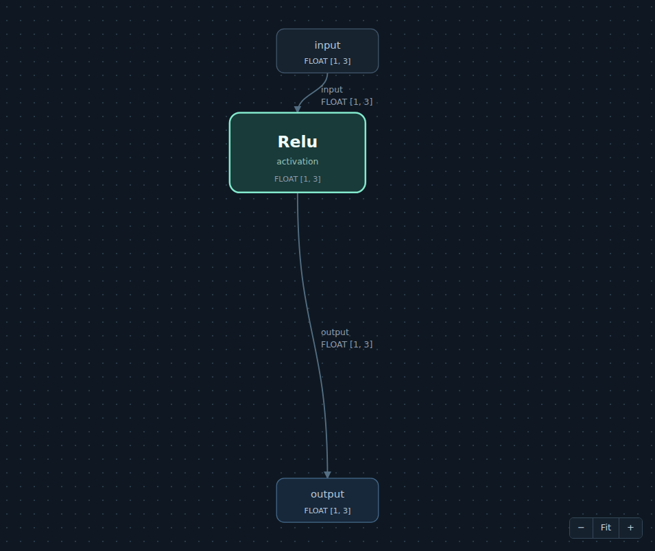

Zoom, navigation and moving nodes
=================================

Operators use a deterministic top-to-bottom Sugiyama layout. Dependencies set
the rows; parallel branches can share a row, with spacing based on block sizes.
Four barycentric sweeps reduce crossings without adding intermediate nodes
along long connections.

Features are grouped by theme:

* **Navigation** includes Model, Statistics, Memory and Tensors, with Open,
  Save, Find, Op and Data controls in the model sidebar.
* **Convert** groups model conversion controls in the sidebar.
* **Optimization** groups Optimize, Fuse and Unfuse in the sidebar.
* **Application** includes Logs, Status, Controls, ONNX links and Settings.

The **Controls** tab under **Application** groups keyboard shortcuts, mouse
gestures and navigation buttons into two-column tables: **Control** and
**Action**. It is available even before a model is loaded.

Graph navigation buttons are stacked in the bottom-left corner in paired rows:
**Top** / **Bottom**, **+** / **-**, then **Fit** / **Zoom to readable size**.
**Zoom area** spans the final row.

* **+**, **-** or Ctrl+wheel zoom without rearranging nodes. Ctrl+wheel zooms
  around the pointer, both in and out. **Fit** recenters the view and includes
  nodes moved outside the original layout.
* Click **Zoom area**, then drag a rectangle over any part of the graph to
  magnify it. The button stays filled, outlined and checked while the mode is
  armed, even after focus moves to the graph. Alt+drag also works, including over
  nodes and subgraph links, without opening the subgraph. The mode ends after one
  drag; Escape cancels it. Selection and node positions are preserved. Area zoom
  uses the same minimum zoom as the buttons, even when the drag ends outside the
  canvas.
* The **Zoom to readable size** icon beside **Fit** jumps directly to 100%,
  centered on the inspected node, without repeated **+** clicks.
  Large graphs omit unreadable text in overview and only paint nodes and
  connections intersecting the viewport, with a small margin for panning.
* With focus in the graph or its zoom controls, **F** fits the graph, **R**
  jumps to readable size, and **+** / **-** zoom in / out.
* Graphs with at least 250 nodes, including input and output ports, open at
  readable size. Only nearby SVG elements are created and attached; **Fit**
  uses two batched paths rather than
  thousands of interactive elements. Long connections crossing the viewport
  are batched when their labels are offscreen.
* **Find node or operator**, above the sidebar inspector, searches the whole
  graph by node name or operator, including offscreen nodes. Matching is
  case-insensitive. As you type, up to 20 suggestions show matching node names
  and operators. Click a suggestion (or Tab to it and press Enter) to select and
  center that node at readable size. Press Enter in the search field or **Go**
  to cycle through all matches.
* Wheel scrolling moves the view vertically; Shift+wheel moves it horizontally.
  Horizontal trackpad scrolling is supported. Large graphs combine wheel events
  into one redraw per animation frame without dropping scroll distance.
* Drag the background to move the model view without rearranging nodes or
  changing selection. Escape cancels the movement.
* Drag an operator, input or output to move it. Connections and tensor labels
  follow, including while zoomed. Drag a selected node to move the selection.
* Selected operators, inputs and outputs have a blue fill and a thick gold
  border, distinct from the mint hover outline. The selection border keeps its
  screen width while zooming; high-contrast mode uses system selection colors.
* Ctrl, Cmd or Shift+click adds an unselected node or removes a selected one
  without changing the other selected nodes. Hold Ctrl, Cmd or Shift while
  dragging a rectangle on the background to add a group to the selection.
  Click the background to clear selection.
* Ctrl+A (Cmd+A on macOS) selects all nodes when the graph has focus.
  Enter or Space selects a focused node. Escape cancels a drag/selection
  rectangle, or clears selection when no gesture is active.
* **Refresh positions** restores the hierarchical layout and fits the view,
  resetting manual moves while preserving inferred shapes and selection.
  Resizing the editor preserves node positions and zoom.
