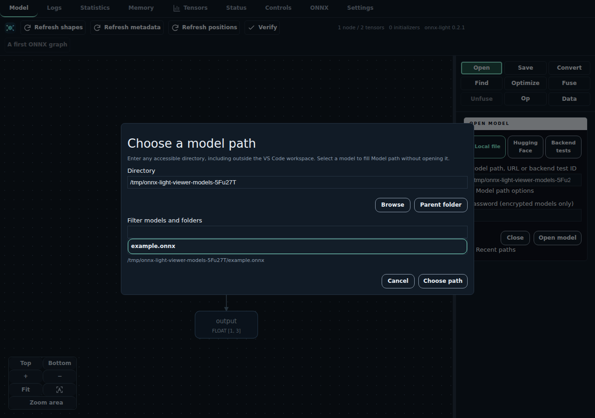
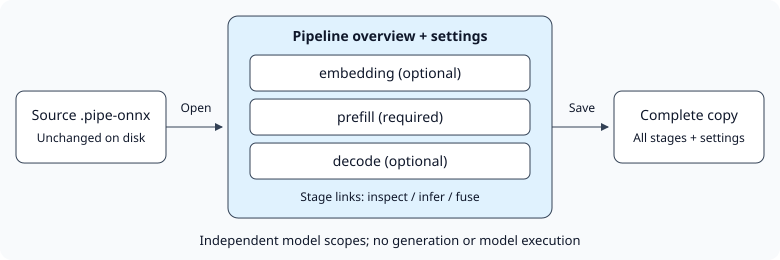

Opening models
==============

* **Open** toggles an embedded file selector in the right sidebar, offering
  **Local file**, **Hugging Face** or **Backend test**. Enter a model path or use
  the buttons below it to choose a local file, then click **Open model**.
  The panel closes after a successful opening;
  **Open** can show it again. Errors and cancellations keep the panel open.
  Opening an ``.onnx`` or ``.pipe-onnx`` file in VS Code
  also uses the viewer; use **Reopen Editor With...** if another editor handles it.
* **ONNX Light Viewer: Open Graph** opens the bundled Relu demo.
  **ONNX Light Viewer: Open Symbolic Transformer Example** opens a bundled,
  randomly initialized transformer graph with symbolic batch/sequence dimensions.
* The toolbar shows the native onnx-light C++ release, graph counts, refresh
  progress and errors. Its logo links to the GitHub repository.
  Loading failures also display an error panel directly over the graph canvas,
  including when the first model cannot be opened. The previous graph, if any,
  is preserved; use **Open** to try another file.

Choosing a local path
---------------------

Buttons directly below **Model path** offer both the existing **VS Code file picker**
and **Browse folders**, an in-app dialog. The latter accepts any accessible directory,
including outside the VS Code workspace; enter a directory, click **Browse**,
or use **Parent folder**. Filter the list, select a model and click **Choose path**
(or double-click it) to fill **Model path** without loading the model.
**Cancel** or Escape leaves the previous model path unchanged.

Opening the Open panel does not list local directories until browsing is requested.
Selecting a recent local directory opens the dialog with that path but does not
browse automatically. Hugging Face discovery and the backend catalogue remain
in the sidebar.

   Choose a path outside the workspace without changing VS Code's file picker.

PipelineProto containers
------------------------

Open an onnx-light ``PipelineProto`` using the ``.pipe-onnx`` extension. The
overview lists the required **prefill** model and optional **embedding** and
**decode** models. Click a stage link to inspect its graph, subgraphs and local
functions; breadcrumbs return to the overview.
Overview boxes represent contained models, not operators. Selecting one shows its
stage role, graph name, operator count and all imported domains/opsets in **Op**;
the overview counter counts models. Use the model link to enter its graph.
The permanent navigation bar also links directly to every available stage,
including while viewing another stage or one of its subgraphs. Nested graph
and function names follow the stage links.

For a ready-to-open example, use
:download:`examples/tiny.pipe-onnx <../../examples/tiny.pipe-onnx>`.
It contains three small, coherent stages with symbolic batch/sequence dimensions
and a three-token vocabulary. Open **prefill**, preview **TransposeTranspose**,
apply the match, then save a ``.pipe-onnx`` copy and reopen it. The transpose pair
becomes an Identity while **embedding**, **decode** and generation settings remain
present. **Refresh shapes** exposes the intermediate transpose dimensions.

The same fixture is stored in ``test/models/tiny.pipe-onnx`` and loaded by the
native integration tests. Regenerate both copies from the repository root with
onnx-light on ``PYTHONPATH``:

.. code-block:: bash

   python3 examples/generate_pipeline.py

         Stage actions affect the selected model; Save writes the entire container.

   Inspect or transform one stage; save all stages and pipeline settings together.

**Refresh metadata** on the overview shows a bounded preview of the stored
generation settings, interface names and pipeline metadata. Inside a stage,
metadata analysis and shape inference use that model's own opsets and types.
Fusion patterns are available at each stage's root, not on the overview or
inside nested graphs. The overview namespaces stage ports: it is a container
view, not an execution graph or a reconstruction of the generation loop.
The viewer does not execute pipelines.

**Save** always writes the complete ``PipelineProto``, including unchanged
stages, generation settings, metadata and in-memory shape or fusion changes.
Choose embedded weights, separate weight files, or reuse existing external
weights in the source folder. External references are relative to the local
pipeline file; generated weight filenames distinguish stages.
The default copy ends in ``-copy.pipe-onnx``. Pipeline encryption is unavailable
in onnx-light and is disabled in the save selector.

Local pipelines load off-thread with bounded ordinary tensor payloads. Omitted
payloads are recovered from the unchanged source when saving or transforming,
as for ModelProto. Encoded payloads retain the existing ModelProto loading
behavior. Malformed or duplicate stages fail explicitly; a pipeline containing
unsupported ``training_info`` can be inspected but cannot be exported.

Recent paths and progress
-------------------------

Successful opens and saves remember their model paths and containing folders;
Hugging Face opens remember the public model URL and repository instead of a
cache filename. **Open** and **Save** keep separate, deduplicated histories,
with the most recent entries first (up to 50 entries each). They persist in
VS Code's user storage across viewer reloads and application restarts.
Failed or cancelled operations and browsing alone do not add entries.

Type in a model-path or location field to filter its native suggestions; use
the arrow keys and Enter to select one, or keep typing any new path. Open
suggestions follow the selected source. **Recent paths** also offers buttons
to fill either field, **Remove** for individual entries and **Clear Open/Save
history**. Selecting history never opens, browses or saves automatically.
Paths are still validated when used, even if remembered. Passwords and URL
credentials, query strings and fragments are not stored in history.

The Open and Save panels show progress bars during their operations. Native
loading and serialization use indeterminate progress rather than an estimated
percentage. Downloads show received bytes and a determinate bar when the server
supplies a usable total size; otherwise the bar stays indeterminate. Progress
ends on success, failure or cancellation.

Plain and encrypted ModelProto files
-------------------------------------

The viewer detects onnx-light encrypted model envelopes by their header,
independently of the filename. It reads **ONNXCRY1** (legacy AES-256-CBC),
**ONNXCRY2** (ChaCha20-Poly1305) and **ONNXCRY3** (AES-256-GCM).
Open them through **Local file**, or open an ``.onnx.enc`` file directly in
VS Code. The sidebar has a masked password field; opening an encrypted file
directly in VS Code uses a masked VS Code prompt instead. A wrong password or
damaged file produces a visible error and keeps the previous model.
Sidebar password fields are cleared after submission or closing the selector;
passwords are never written to settings or logs. They remain in the
extension host's memory while the model is open so native recovery can reload it.

**Open** and **Save** sit side by side with the same design. **Save** toggles an
embedded panel with a destination-folder browser, destination path, storage and
encryption options. File selection and password confirmation stay inside the
sidebar; no popup save dialog is used.

.. list-table::
   :header-rows: 1

   * - Weight storage
     - Plain
     - Encrypted
   * - Embedded
     - One self-contained ``.onnx`` file
     - One self-contained ``.onnx.enc`` file, including all weights
   * - External
     - An ``.onnx`` file and separate weight files
     - Shown but unavailable pending `onnx-light#5533
       <https://github.com/xadupre/onnx-light/issues/5533>`_

Encrypted output uses **AES-256-GCM / ONNXCRY3** and asks for password confirmation.
The default filename ends in ``-copy.onnx`` or ``-copy.onnx.enc``; choose a
different destination from the source model and its external weight files.
Existing copies are only replaced when **Replace an existing destination copy**
is checked. The source model and its external weights remain protected.
Saving always includes the whole ModelProto, not just the selected graph,
with stored metadata, all weights
and any persisted shape inference. It does not change the displayed selection,
layout or camera. A temporary file is written first and renamed only after the
write succeeds; failures and cancellations appear in Logs.

Models containing ``training_info`` can be inspected, but all export modes
explicitly reject them: the pinned onnx-light 0.2.2 does not preserve training
or initialization graphs. This avoids silently producing an incomplete copy.
Local source aliases (including symlinked directories, hard links and case
aliases on case-insensitive volumes) are rejected as save destinations.

Saving resolves existing external weights relative to the local source model.
Embedded output incorporates them into the saved proto, so encrypted output
protects them too. External output copies and repartitions the weights, without
modifying the originals. Missing weight files fail explicitly before writing.
External weights from virtual sources require opening a local copy with its
weight files available; Hugging Face weight files are not downloaded automatically.

For external output, choose the **maximum weight file size in MiB**
(1 MiB = 1,048,576 bytes). The default is 5120 MiB (5 GiB). This is a file-size limit,
not an I/O buffer size. One tensor cannot span files, so the limit must fit the
largest tensor; an insufficient limit is reported as an error.
Small tensors, strings and sparse components may remain inline according to
the native serializer.
Weight files have unique names alongside the proto and are published first;
the proto is replaced last, after every weight file succeeds. Failure removes
new weight files and leaves an existing destination intact. Existing weight
files are never replaced or deleted.
Closing the panel or replacing its model during a temporary write cancels
publication and removes new temporary and external files.

Plain local files still load with bounded tensor payloads. Saving rereads any
omitted inline data from their source, so the source must remain available and
unchanged; detected changes require reopening it. Encrypted models are decrypted
fully in native memory, and serialization also needs a complete in-memory
payload. Local-file decryption and serialization run on native workers; virtual
files use VS Code's filesystem and the synchronous byte-buffer loader.
Decrypted data is written to disk only when explicitly saving
a plain copy; downloaded encrypted files remain encrypted in the cache.
Malformed decrypted models produce content-free errors, so parser diagnostics
cannot expose decrypted bytes in Logs.

Payload omission applies to tracked ``TensorProto`` raw and typed data: dense
initializers, sparse components and tensors in attributes, nested graphs and
functions. Internally, omitted tensors use the
``onnx-light-viewer:payload-omitted`` location sentinel, which is not reported
as an external filename. ``EncodedValueProto`` payloads and their layout
constants are not tracked by this omission pass: inline encoded bytes remain
in memory, even above the tensor omission threshold, and genuinely external
encoded payloads retain their external filenames. The loader does not generate
the omission sentinel for encoded values (investigation: `#144
<https://github.com/xadupre/onnx-light-viewer/issues/144>`_).

Hugging Face models
-------------------

Choose **Open**, then use the **Local file**, **Hugging Face** or **Backend tests**
source buttons. **Hugging Face** initially shows popular public ONNX repositories,
ranked by download count. Under **1. Find an ONNX model**, choose a **Task**
(embeddings, generation, classification, vision, speech, etc.), enter a model
name or author and click **Search** or press Enter. An empty search shows popular
models for that task.
Search results progressively show the smallest/largest known ONNX file sizes
and the number of variants with size metadata, without downloading any model.
Select a repository to browse its ONNX variants, then double-click a file to
download and open it. A single click only selects a file; the **Open model**
button remains available for keyboard and manual-path entry.
Under **2. Choose an ONNX file**, file sizes appear in KiB/MiB/GiB when supplied
by the Hub; they do not include separately stored external weights. No size is
invented when metadata is missing; missing sizes and metadata errors are explicit.
Results are repositories tagged ``onnx`` on the Hub, not a guarantee that every
variant is supported by the native viewer.

Expand **Or enter a repository / URL** to browse a known public repository ID such as
``onnx-community/Kokoro-82M-v1.0-ONNX``, its URL
(``https://huggingface.co/onnx-community/Kokoro-82M-v1.0-ONNX``), or the URL of an
``.onnx`` file. For a repository, the extension lists its ONNX files and lets you
choose a variant; a single ONNX file is selected automatically.

For direct file URLs, both the file page (``/blob/``) and direct download
(``/resolve/``) links are accepted, including nested paths and pinned revisions.
For example:

.. code-block:: text

   https://huggingface.co/hf-internal-testing/tiny-random-bert/blob/main/onnx/model.onnx

The extension downloads the file with a cancellable progress notification, loads
it through the native viewer and retains it in its persistent Hugging Face
cache. Later openings of the same normalized URL use the cached file without
network access when opened by file URL, including after restarting VS Code.
Opening a repository still needs network access to list its files.
Logs distinguish downloads
from cache hits and include the cached file's location. Native inspection,
subgraph navigation and refresh controls work as for a local model.

Only the requested ONNX file is downloaded: external weight files, Python code
and other repository contents are not fetched. Models are neither executed nor
uploaded. Private or gated repositories and authentication tokens are not
supported. Download, parsing and filesystem errors appear in Logs and VS Code
notifications; cancellation or failure keeps the previous model visible.

Partial or unparseable downloads never become cache entries. Different file
paths or revisions have separate entries, while equivalent blob/resolve links
share one. Cached branch URLs are not automatically checked for remote updates;
use a commit-pinned URL for reproducibility, or remove that entry at the location
shown in Logs before downloading an updated branch file.
