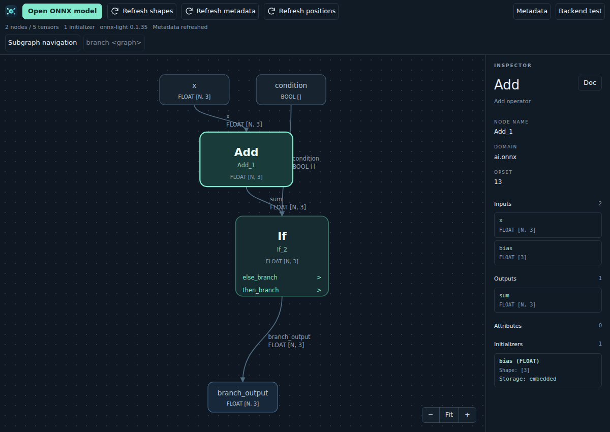

Subgraphs
=========

Explore graph attributes of operators such as **If**, **Loop** and **Scan**.
Click a subgraph entry inside the operator's rectangle, or **Open** in the
inspector. Entries support Tab followed by Enter or Space; dragging the
operator's header still moves it. Each graph in a graph-list attribute has its
own entry. The breadcrumb bar remains visible on the main graph, showing the
model's root name. Subgraph and function names are appended as you navigate;
click an ancestor to return to it.

Nested graphs retain enclosing opsets and captured tensor/initializer
information. Captured values appear as input ports; captured initializers stay
in the parameter list. The inspector lists implicit **Captured inputs**.
**Refresh shapes** infers the enclosing model and updates the displayed subgraph,
including intermediate ``value_info`` retained in its native graph.

Model-local functions
---------------------

Click the background to inspect the model, then choose an entry in
**Local functions**, below the initializer lists, to open its definition.
The list includes unused functions and distinguishes domains and overloads.
For pipelines, open a contained model's graph first. Breadcrumbs return to the
model.

Nodes calling a function defined in the model have a **Function** entry and an
**Open function** inspector button. Open either to explore the definition, then
use breadcrumbs to return to the caller. Nested function calls and graph
attributes inside functions use the same navigation. Definitions are matched by
domain, name and overload.

The displayed body uses the function's own opset imports and formal input/output
names. It does not inherit the caller's weights or specialize shapes and
attributes for that call. Graph attributes inside the body can still capture
values from the function. Shape and metadata refreshes keep the selected body
open; shape refresh runs on the enclosing model.

:download:`Example model with nested function calls and an If body
<../../test/models/functions.onnx>`.
