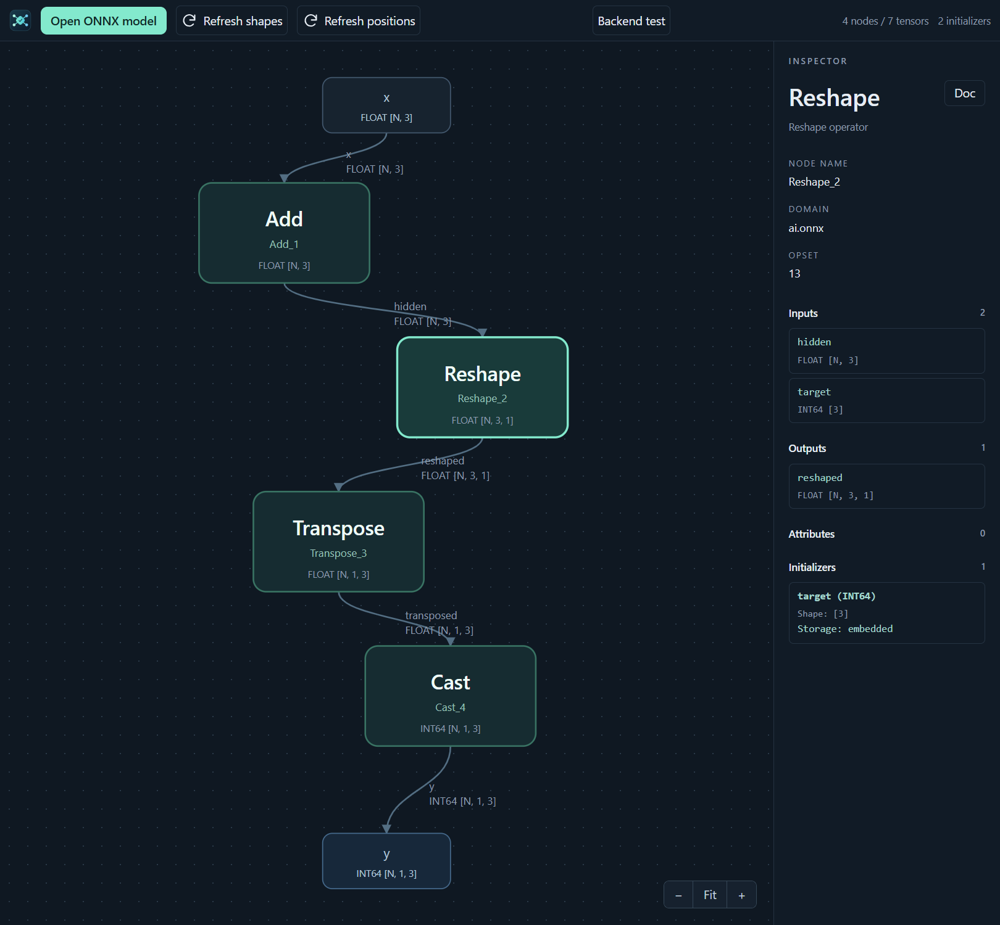

ONNX Light Viewer
=================

Version: |release|

.. image:: https://github.com/xadupre/onnx-light-viewer/actions/workflows/tests.yml/badge.svg?branch=main
   :target: https://github.com/xadupre/onnx-light-viewer/actions/workflows/tests.yml
   :alt: CI

.. image:: https://codecov.io/gh/xadupre/onnx-light-viewer/branch/main/graph/badge.svg
   :target: https://codecov.io/gh/xadupre/onnx-light-viewer
   :alt: Code coverage

ONNX Light Viewer explores ONNX models in VS Code, powered by native onnx-light.
Open local files, cached public Hugging Face models or bundled backend test
graphs. Search and navigate nodes, nested subgraphs and model-local functions;
inspect operators, small tensor values and Markdown schema documentation.
Refresh inferred shapes/types and static metadata without changing the source.
Logs and Status retain operation progress, timing and error details.

The current viewer does not execute or optimize models. See :doc:`features` for
the implemented feature checklist and a separate list of planned/in-progress
capabilities, including model saving and encrypted I/O. Start with
:doc:`getting_started` for a guided inspection and copyable shell/Python examples.

   Explore tensor shapes and inspect the selected node's parameters.

.. toctree::
   :maxdepth: 1

   getting_started
   features
   design
   development
   links
