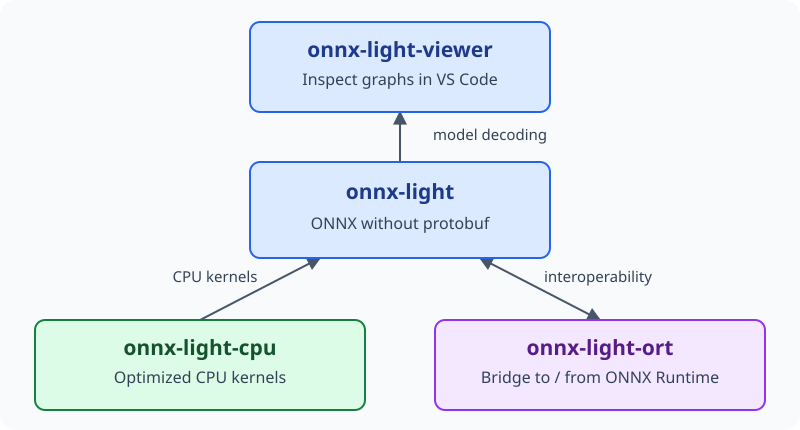
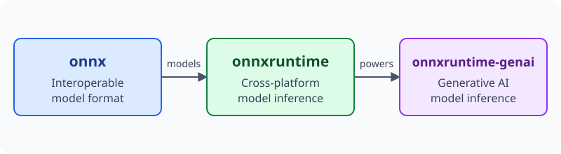
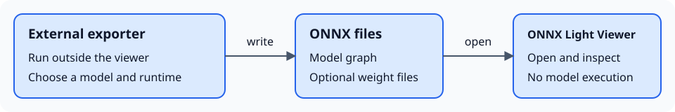

Links
=====

Related projects and export tools in the ONNX ecosystem.
The viewer's **ONNX** tab groups project and **Exporters** cards in the same
design, with the packages or ecosystems each project specializes in.
Each card's book icon opens the project's documentation; the project name
opens its source repository.

onnx-light projects
-------------------

         CPU kernels and onnx-light-kernel-images provides ImageDecoder kernels
         for onnx-light, and onnx-light-ort bridges onnx-light and ONNX Runtime
         in both directions.
   :width: 100%

   Local model inspection, CPU execution, image decoding, and ONNX Runtime
   interoperability.

* `onnx-light-viewer <https://github.com/xadupre/onnx-light-viewer>`_: this VS Code
  extension for inspecting ONNX graphs locally without executing models.
  **Specialized for:** VS Code model inspection with ``onnx-light``.
  `Documentation <https://xadupre.github.io/docs/onnx-light-viewer/>`__.
* `onnx-light <https://github.com/xadupre/onnx-light>`_: ONNX without protobuf,
  used by this viewer to decode models locally.
  **Specialized for:** ONNX model I/O and graph analysis with ``onnx-light``.
  `Documentation <https://sdpython.github.io/doc/onnx-light/dev/index.html>`__.
* `onnx-light-cpu <https://github.com/xadupre/onnx-light-cpu>`_: optimized CPU
  kernels for onnx-light.
  **Specialized for:** ``onnx-light`` CPU execution.
  `Documentation <https://xadupre.github.io/docs/onnx-light-cpu/>`__.
* `onnx-light-kernel-images <https://github.com/xadupre/onnx-light-kernel-images>`_:
  ImageDecoder kernel extension for onnx-light.
  **Specialized for:** image decoding with ``onnx-light``.
  `Documentation <https://xadupre.github.io/docs/onnx-light-kernel-images/>`__.
* `onnx-light-ort <https://github.com/xadupre/onnx-light-ort>`_: bidirectional
  interoperability between onnx-light and ONNX Runtime custom operators and
  execution providers.
  **Specialized for:** ``onnx-light`` and ``onnxruntime`` interoperability.
  `Documentation <https://xadupre.github.io/onnx-light-ort/>`__.

ONNX and ONNX Runtime
---------------------

         ONNX Runtime powers generative AI inference in onnxruntime-genai.
   :width: 100%

   From a shared model format to general inference and generative AI.
   onnx-light reads the same ONNX format; onnx-light-ort connects it to
   ONNX Runtime.

* `onnx <https://github.com/onnx/onnx>`_: the open standard for machine learning
  model interoperability.
  **Specialized for:** framework-independent model interchange with ``onnx``.
  `Documentation <https://onnx.ai/onnx/>`__.
* `onnxruntime <https://github.com/microsoft/onnxruntime>`_: a cross-platform
  runtime for machine learning models.
  **Specialized for:** ONNX model execution with ``onnxruntime``.
  `Documentation <https://onnxruntime.ai/docs/>`__.
* `onnxruntime-extensions <https://github.com/microsoft/onnxruntime-extensions>`_:
  custom operators and tools for preprocessing and postprocessing.
  **Specialized for:** ``onnxruntime`` preprocessing and postprocessing with
  ``onnxruntime-extensions``.
  `Documentation <https://onnxruntime.ai/docs/extensions/>`__.
* `onnxruntime-genai <https://github.com/microsoft/onnxruntime-genai>`_:
  generative AI model inference with ONNX Runtime.
  **Specialized for:** generative model execution with ``onnxruntime-genai``.
  `Documentation <https://onnxruntime.ai/docs/genai/>`__.

Exporters
----------

Use **Convert** to run an installed mbext, modelbuilder, Mobius or Olive exporter, or
open a model exported separately. See :doc:`features/exporting_models`.
Supported models, operators and target runtimes vary by tool.

         files. ONNX Light Viewer opens the resulting model for inspection.
   :width: 100%

   Conversion runs in a separate Python process; opening the resulting model does
   not execute its graph.

* `Olive <https://github.com/microsoft/Olive>`_:
  model optimization and quantization with ``olive-ai``.
  **Specialized for:** local ONNX INT4/INT8 quantization in the viewer.
  `Documentation <https://microsoft.github.io/Olive/>`__.
* `Olive recipes <https://github.com/microsoft/olive-recipes>`_:
  model-specific export and optimization workflows, distinct from Olive's
  quantization command. The viewer caches the catalogue by Git commit and shows
  recipe-specific Olive version requirements.
  **Specialized for:** model-specific ``olive-ai`` workflows.
  `Recipe documentation <https://github.com/microsoft/olive-recipes#readme>`__.
* `Mobius <https://github.com/onnxruntime/mobius>`_:
  builds ONNX graphs with ONNX Script and pretrained weights rather than
  tracing a PyTorch model.
  **Specialized for:** Hugging Face Transformers and Diffusers models,
  including ONNX Runtime GenAI workflows.
  `Documentation <https://onnxruntime.github.io/mobius/>`__.
* `modelbuilder (ONNX Runtime GenAI)
  <https://github.com/microsoft/onnxruntime-genai/tree/main/src/python/py/models>`_:
  builds optimized and quantized ONNX graphs for supported generative AI
  architectures.
  **Specialized for:** Hugging Face Transformers models targeting
  ``onnxruntime-genai``.
  `Documentation <https://onnxruntime.ai/docs/genai/howto/build-model.html>`__.
* `mbext <https://github.com/xadupre/mbext>`_:
  a rewrite using ``onnx-light`` for faster ONNX model construction and export.
  **Specialized for:** Hugging Face Transformers models targeting
  ``onnxruntime-genai``, using ``onnx-light`` through the ``modelbuilder`` package.
  `Documentation <https://xadupre.github.io/docs/mbext/index.html>`__.
* `yet-another-onnx-builder
  <https://github.com/xadupre/yet-another-onnx-builder>`_:
  uses ``onnx-light`` for ONNX graph construction, optimization and shape
  inference, with the ``yobx.to_onnx`` conversion API.
  **Specialized for:** PyTorch, TensorFlow/Keras/LiteRT, scikit-learn,
  scikit-survival, category_encoders, imbalanced-learn, statsmodels, XGBoost and
  LightGBM, plus NumPy function tracing, using ``yobx`` and ``onnx-light``.
  SQL queries, pandas/Polars-style DataFrame transformations and JAX support
  are in progress.
  `Documentation
  <https://xadupre.github.io/docs/yet-another-onnx-builder/index.html>`__.
* `sklearn-onnx <https://github.com/onnx/sklearn-onnx>`_:
  converts supported estimators and pipelines through ``skl2onnx``.
  **Specialized for:** scikit-learn models and pipelines.
  `Documentation <https://onnx.ai/sklearn-onnx/>`__.
* `tensorflow-onnx <https://github.com/onnx/tensorflow-onnx>`_:
  converts models through ``tf2onnx``; TensorFlow.js support is experimental.
  **Specialized for:** TensorFlow, Keras, TFLite and TensorFlow.js.
  `Documentation
  <https://github.com/onnx/tensorflow-onnx/blob/main/README.md>`__.
* `onnxmltools <https://github.com/onnx/onnxmltools>`_:
  converts models from multiple machine-learning toolkits, including
  boosted-tree libraries.
  **Specialized for:** XGBoost, LightGBM, CatBoost, Core ML and other ML toolkits.
  `Documentation <https://onnx.ai/onnxmltools/>`__.

The **Convert** panel supports mbext, modelbuilder and Mobius. Other project links
do not imply built-in export integration.
